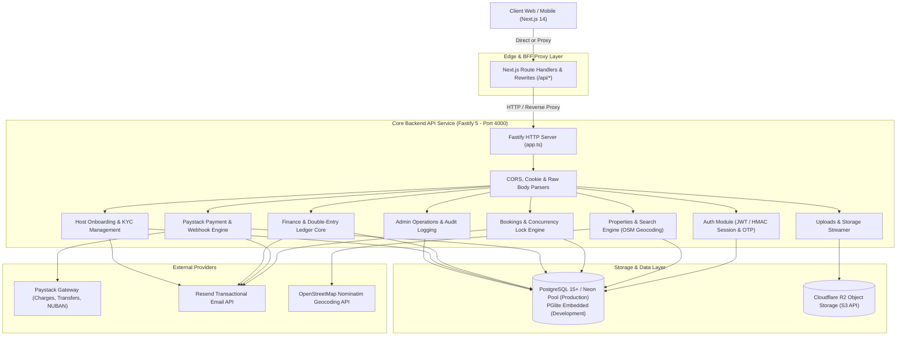
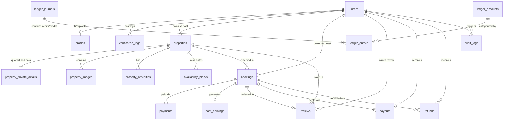
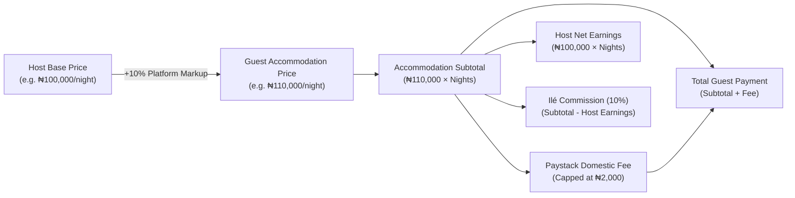
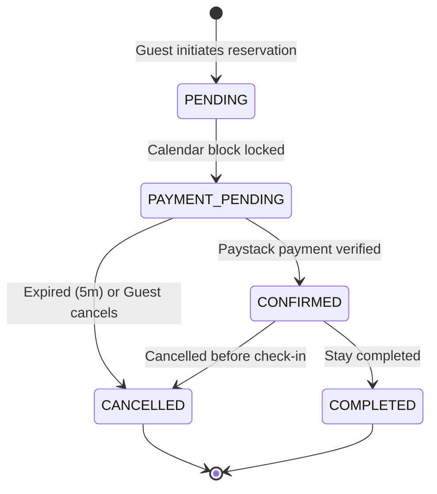
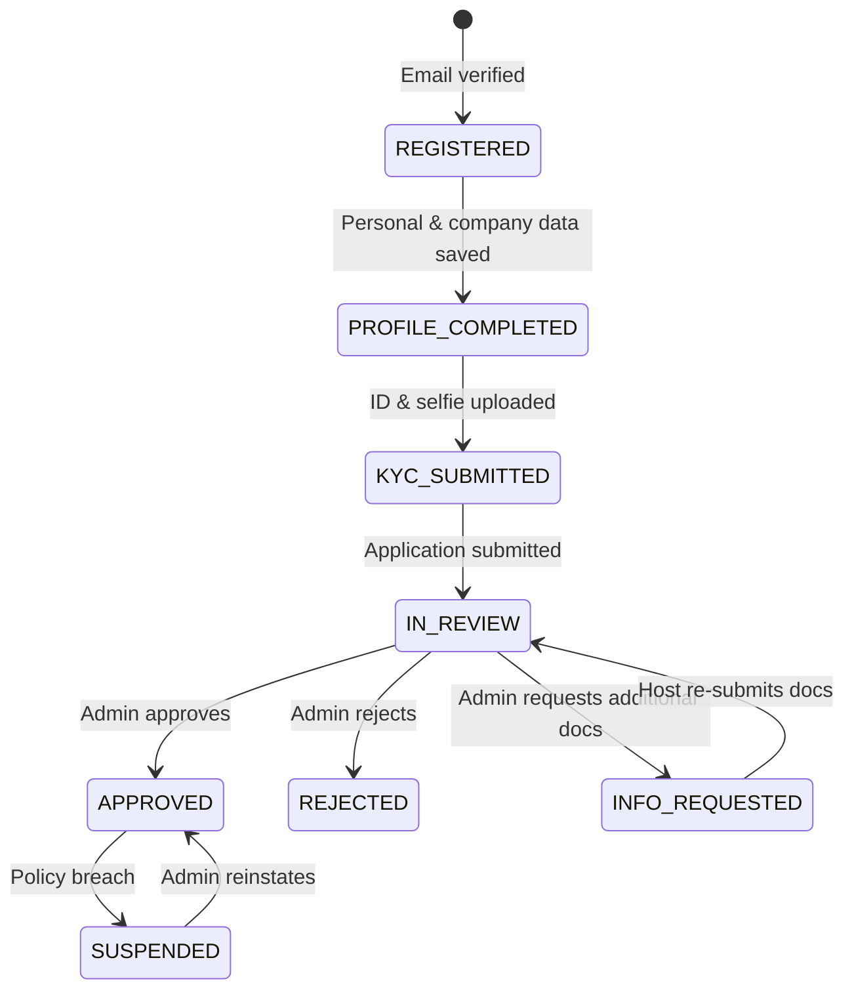
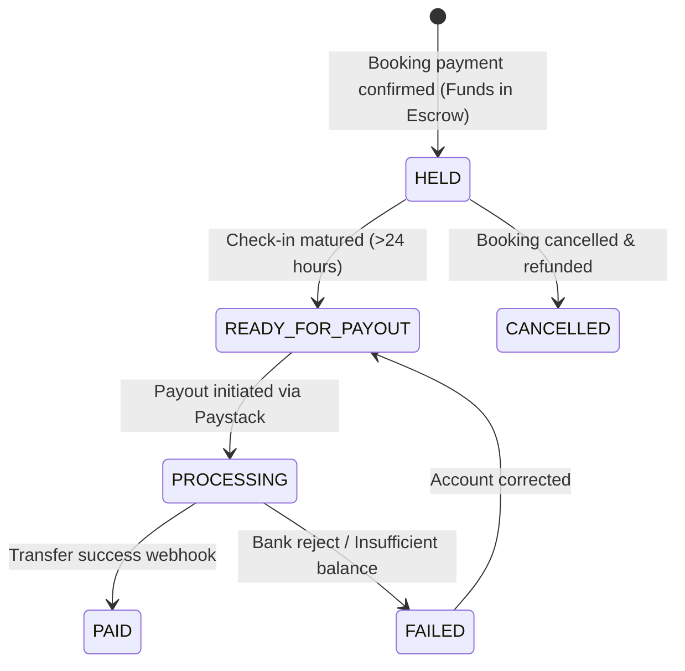
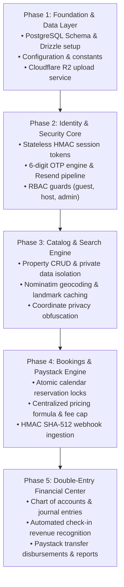

# Ilé Backend Architecture & Design Specification

> **Document Purpose:** Complete technical specification of the Ilé backend architecture, data models, financial ledger, security protocols, API endpoints, and third-party integrations. This document serves as the authoritative blueprint for reproducing, refactoring, or redesigning an exact copy of the backend.

---

## Table of Contents
1. [System Architecture & Topology](#1-system-architecture--topology)
2. [Environment Configuration & Constants](#2-environment-configuration--constants)
3. [Database Architecture & Data Dictionary](#3-database-architecture--data-dictionary)
4. [Authentication, Identity & Security Engine](#4-authentication-identity--security-engine)
5. [Authoritative Pricing & Fee Calculation Engine](#5-authoritative-pricing--fee-calculation-engine)
6. [Double-Entry General Ledger & Settlement Pipeline](#6-double-entry-general-ledger--settlement-pipeline)
7. [Comprehensive REST API Catalog](#7-comprehensive-rest-api-catalog)
8. [Third-Party Integrations & Infrastructure](#8-third-party-integrations--infrastructure)
9. [Domain State Machines & Lifecycles](#9-domain-state-machines--lifecycles)
10. [Redesign & Replication Blueprint](#10-redesign--replication-blueprint)

---

## 1. System Architecture & Topology

### 1.1 High-Level Overview
Ilé is a luxury short-let hospitality marketplace built specifically for the Nigerian ecosystem (primary operating hubs: Abuja and Lagos). The backend provides end-to-end functionality for:
- Guest search, geocoding with Nigerian landmark resolution, and dynamic availability checks.
- Booking reservations with concurrency-safe database locks preventing double-booking.
- Strict Paystack payment processing (checkout initialization, timing-safe HMAC SHA-512 webhooks, and domestic transfer disbursements).
- Quarantined private stay details (exact address, gate codes, host contact) hidden until payment confirmation.
- 6-step host onboarding, biometric webcam liveness verification, and NUBAN bank account resolution.
- Enterprise-grade **Double-Entry General Ledger** (Chart of Accounts, strict zero-sum journal postings, automated check-in revenue recognition, and host payout scheduling).
- Cloudflare R2 object storage streaming and Resend transactional notification pipeline (20+ email lifecycle templates).

### 1.2 Architectural Topology



### 1.3 Dual-Mode Deployment Architecture
The codebase accommodates two execution modes:
1. **Production Deployment (Render / Railway / Docker):**
   - Entry point: `backend/src/server.ts` listening on `0.0.0.0:${PORT:-4000}`.
   - Next.js acts as a decoupled frontend consuming the Fastify API or proxying via `next.config.mjs` fallback rewrites:
     ```javascript
     {
       source: "/api/:path*",
       destination: `${process.env.BACKEND_URL || "https://il-production.up.railway.app"}/api/:path*`
     }
     ```
2. **Local Zero-Dependency Development:**
   - Database: Embedded `@electric-sql/pglite` database stored under `.data/ile_dev.db` when `DATABASE_URL` is omitted.
   - Payments: Automated mock transfers and sandbox Paystack credentials.

---

## 2. Environment Configuration & Constants

### 2.1 Environment Schema (`backend/src/config/env.ts`)

| Variable | Type | Default | Description |
|---|---|---|---|
| `NODE_ENV` | enum | `development` | `development`, `production`, or `test` |
| `PORT` | number | `4000` | Port for the Fastify server |
| `LOG_LEVEL` | enum | `info` | Fastify logger level: `fatal`, `error`, `warn`, `info`, `debug`, `trace` |
| `DATABASE_URL` | string (URL) | *Optional* | Pooled Postgres connection string (Neon / AWS RDS / Supabase) |
| `DATABASE_URL_UNPOOLED` | string (URL) | *Optional* | Direct connection string for schema migrations |
| `SESSION_SECRET` | string | *32 chars min* | Secret key for signing HMAC SHA-256 session tokens and Fastify cookies |
| `SESSION_MAX_AGE_DAYS`| number | `7` | Session lifetime in days |
| `FRONTEND_URL` | string (URL) | `https://ilestays.ng` | Allowed origin for CORS in production |
| `PAYSTACK_SECRET_KEY` | string | *Optional* | Paystack secret key (`sk_live_...` or `sk_test_...`) |
| `PAYSTACK_PUBLIC_KEY` | string | *Optional* | Paystack public key (`pk_live_...` or `pk_test_...`) |
| `EMAIL_PROVIDER` | enum | `resend` | `resend`, `sendgrid`, or `console` |
| `RESEND_API_KEY` | string | *Optional* | Resend API key (also accepts alias `EMAIL_API_KEY`) |
| `EMAIL_FROM` | string | `Ilé <hello@notifications.ilestays.ng>` | Default sender address |
| `EMAIL_SUPPORT` | string | `support@ilestays.ng` | Customer support recipient |
| `EMAIL_ENQUIRIES` | string | `info@ilestays.ng` | General enquiries address |
| `R2_ACCOUNT_ID` | string | *Optional* | Cloudflare account ID |
| `R2_ACCESS_KEY_ID` | string | *Optional* | Cloudflare R2 S3 access key ID |
| `R2_SECRET_ACCESS_KEY`| string | *Optional* | Cloudflare R2 S3 secret access key |
| `R2_BUCKET_NAME` | string | `storageapp` | Target R2 bucket name |
| `R2_FOLDER_PREFIX` | string | `storageapp/ilestays.ng/` | Key path prefix in bucket |
| `R2_PUBLIC_URL` | string (URL) | *Optional* | Custom domain or public dev URL for R2 assets |
| `GEOCODING_API_URL` | string (URL) | `https://nominatim.openstreetmap.org` | OpenStreetMap Nominatim endpoint |

### 2.2 Core Business Constants (`backend/src/config/constants.ts`)

```typescript
// Currency & Economics
export const DEFAULT_CURRENCY = "NGN";
export const PLATFORM_COMMISSION_PCT = 8;          // Default legacy base (overridden by platform_settings: 10%)
export const DEFAULT_CLEANING_FEE_PCT = 5;
export const MIN_PRICE_PER_NIGHT = 5_000;           // ₦5,000 floor per night

// Booking Guardrails
export const MIN_NIGHTS = 1;
export const MAX_NIGHTS = 90;
export const MAX_GUESTS = 20;
export const BOOKING_REFERENCE_PREFIX = "ILE";

// Pagination & Search
export const DEFAULT_PAGE_SIZE = 20;
export const MAX_PAGE_SIZE = 100;
export const DEFAULT_SEARCH_RADIUS_KM = 25;
export const MAX_SEARCH_RADIUS_KM = 100;
export const COORDINATE_OFFSET_RANGE = 0.003;       // ±0.003° (~300m) privacy jitter

// Security & Media
export const SESSION_MAX_AGE_SECONDS = 60 * 60 * 24 * 7; // 7 days
export const BCRYPT_SALT_ROUNDS = 10;
export const MAX_FILE_SIZE_BYTES = 15 * 1024 * 1024;     // 15 MB binary limit
export const MAX_IMAGES_PER_PROPERTY = 20;

// Nigerian Infrastructure Specializations
export const POWER_TYPES = [
  "Solar + Inverter",
  "Dual Silent Generator",
  "24/7 Dedicated Grid + Inverter",
  "Generator + Inverter",
  "Full Solar Array",
  "Grid + Solar Hybrid"
] as const;

export const PROPERTY_TYPES = [
  "Apartment", "House", "Villa", "Serviced Apartment", "Studio",
  "Hotel", "Guest House", "Penthouse", "Duplex", "Bungalow"
] as const;
```

---

## 3. Database Architecture & Data Dictionary

The schema is defined using **Drizzle ORM** with PostgreSQL types. All monetary amounts are recorded as integer values in **Nigerian Naira (NGN)** (or minor units if explicitly specified).

### 3.1 Entity Relationship Diagram



### 3.2 Tables Specification

#### 1. `users`
Core user identity for guests, hosts, and platform administrators.
```sql
CREATE TABLE users (
    id VARCHAR(100) PRIMARY KEY,
    email VARCHAR(255) NOT NULL UNIQUE,
    password_hash TEXT NOT NULL,
    first_name VARCHAR(100) NOT NULL,
    last_name VARCHAR(100) NOT NULL,
    phone VARCHAR(30),
    role VARCHAR(20) NOT NULL DEFAULT 'guest',          -- 'guest' | 'host' | 'admin'
    avatar_url TEXT,
    email_verified BOOLEAN NOT NULL DEFAULT FALSE,
    email_verification_code VARCHAR(10),
    email_verification_expires_at TIMESTAMPTZ,
    email_verification_attempts INT NOT NULL DEFAULT 0,
    email_verification_sent_at TIMESTAMPTZ,
    phone_verified BOOLEAN NOT NULL DEFAULT FALSE,
    phone_verification_code VARCHAR(10),
    phone_verification_expires_at TIMESTAMPTZ,
    reset_token VARCHAR(100),
    reset_token_expires_at TIMESTAMPTZ,
    status VARCHAR(30) NOT NULL DEFAULT 'ACTIVE',       -- 'ACTIVE' | 'SUSPENDED' | 'BANNED'
    created_at TIMESTAMPTZ NOT NULL DEFAULT NOW(),
    updated_at TIMESTAMPTZ NOT NULL DEFAULT NOW()
);
```

#### 2. `profiles`
Host KYC, company registration, onboarding lifecycle, and payout bank metadata.
```sql
CREATE TABLE profiles (
    id VARCHAR(100) PRIMARY KEY,
    user_id VARCHAR(100) NOT NULL REFERENCES users(id) ON DELETE CASCADE,
    bio TEXT,
    response_rate VARCHAR(10) DEFAULT '100%',
    response_time VARCHAR(50) DEFAULT 'Within an hour',
    joined_year INT DEFAULT 2026,
    is_verified BOOLEAN DEFAULT FALSE,
    identity_document_url TEXT,
    onboarding_step INT NOT NULL DEFAULT 1,
    onboarding_completed BOOLEAN NOT NULL DEFAULT FALSE,
    verification_status VARCHAR(40) NOT NULL DEFAULT 'REGISTERED', -- 'REGISTERED' | 'PROFILE_COMPLETED' | 'KYC_SUBMITTED' | 'IN_REVIEW' | 'APPROVED' | 'REJECTED' | 'INFO_REQUESTED' | 'SUSPENDED'
    host_type VARCHAR(40),                                        -- 'individual_owner' | 'property_manager' | 'company'
    company_name VARCHAR(255),
    company_reg_number VARCHAR(100),
    residential_address TEXT,
    date_of_birth VARCHAR(30),
    operating_city VARCHAR(100),
    operating_areas TEXT,
    id_type VARCHAR(50),                                          -- 'nin' | 'drivers_license' | 'passport' | 'voters_card'
    id_number VARCHAR(100),
    id_document_back_url TEXT,
    selfieUrl TEXT,                                               -- Captured via biometric liveness
    authority_doc_type VARCHAR(50),                               -- 'deed_of_ownership' | 'management_agreement' | 'utility_bill' | 'cac_certificate' | 'power_of_attorney'
    authority_doc_url TEXT,
    bank_name VARCHAR(100),
    bank_code VARCHAR(20),
    bank_account_number VARCHAR(20),
    bank_account_name VARCHAR(150),
    bank_account_verified_at TIMESTAMPTZ,
    paystack_recipient_code VARCHAR(100),                         -- Paystack Transfer Recipient code (RCP_...)
    property_draft_data TEXT,                                     -- JSON string for preliminary listing draft
    review_feedback TEXT,
    reviewed_by VARCHAR(100),
    reviewed_at TIMESTAMPTZ,
    created_at TIMESTAMPTZ NOT NULL DEFAULT NOW(),
    updated_at TIMESTAMPTZ NOT NULL DEFAULT NOW()
);
```

#### 3. `verification_logs`
Immutable audit log of all host verification state transitions.
```sql
CREATE TABLE verification_logs (
    id VARCHAR(100) PRIMARY KEY,
    host_id VARCHAR(100) NOT NULL REFERENCES users(id) ON DELETE CASCADE,
    admin_id VARCHAR(100) REFERENCES users(id) ON DELETE SET NULL,
    previous_status VARCHAR(40) NOT NULL,
    new_status VARCHAR(40) NOT NULL,
    action VARCHAR(50) NOT NULL,                                  -- 'SUBMIT' | 'APPROVE' | 'REJECT' | 'REQUEST_INFO' | 'SUSPEND' | 'REINSTATE'
    reason TEXT,
    notes TEXT,
    created_at TIMESTAMPTZ NOT NULL DEFAULT NOW()
);
```

#### 4. `properties`
Public property catalog with location, infrastructure specs, and pricing rules.
```sql
CREATE TABLE properties (
    id VARCHAR(100) PRIMARY KEY,
    host_id VARCHAR(100) NOT NULL REFERENCES users(id) ON DELETE CASCADE,
    slug VARCHAR(255) NOT NULL UNIQUE,
    title VARCHAR(255) NOT NULL,
    tagline TEXT,
    description TEXT NOT NULL,
    property_type VARCHAR(50) NOT NULL,
    space_type VARCHAR(50) NOT NULL DEFAULT 'Entire place',
    bedrooms INT NOT NULL DEFAULT 1,
    bathrooms DOUBLE PRECISION NOT NULL DEFAULT 1,
    beds INT NOT NULL DEFAULT 1,
    max_guests INT NOT NULL DEFAULT 2,
    price_per_night INT NOT NULL,                                 -- Guest nightly accommodation rate in NGN
    host_base_price INT,                                          -- Optional explicit host net nightly rate
    cleaning_fee INT NOT NULL DEFAULT 0,
    service_fee_pct INT NOT NULL DEFAULT 8,
    currency VARCHAR(10) NOT NULL DEFAULT 'NGN',
    minimum_nights INT NOT NULL DEFAULT 1,
    city VARCHAR(100) NOT NULL,
    neighborhood VARCHAR(150) NOT NULL,
    state VARCHAR(100) NOT NULL,
    latitude DOUBLE PRECISION NOT NULL,
    longitude DOUBLE PRECISION NOT NULL,
    power_type VARCHAR(100) NOT NULL,
    power_description TEXT,
    internet_description TEXT,
    security_description TEXT,
    water_description TEXT,
    parking_description TEXT,
    cover_image TEXT NOT NULL,
    status VARCHAR(30) NOT NULL DEFAULT 'PENDING_REVIEW',         -- 'DRAFT' | 'PENDING_REVIEW' | 'PUBLISHED' | 'REJECTED' | 'SUSPENDED'
    moderation_status VARCHAR(30) NOT NULL DEFAULT 'NONE',
    moderation_reason TEXT,
    moderated_at TIMESTAMPTZ,
    moderated_by VARCHAR(100),
    rejection_reason TEXT,
    rating DOUBLE PRECISION NOT NULL DEFAULT 5.0,
    review_count INT NOT NULL DEFAULT 0,
    verified BOOLEAN NOT NULL DEFAULT TRUE,
    featured BOOLEAN NOT NULL DEFAULT FALSE,
    created_at TIMESTAMPTZ NOT NULL DEFAULT NOW(),
    updated_at TIMESTAMPTZ NOT NULL DEFAULT NOW()
);
```

#### 5. `property_private_details` (Quarantined Access Data)
Sensitive details disclosed solely to confirmed guests with valid access tokens.
```sql
CREATE TABLE property_private_details (
    id VARCHAR(100) PRIMARY KEY,
    property_id VARCHAR(100) NOT NULL UNIQUE REFERENCES properties(id) ON DELETE CASCADE,
    exact_address TEXT NOT NULL,
    unit_number VARCHAR(50),
    contact_name VARCHAR(100) NOT NULL,
    contact_phone VARCHAR(30) NOT NULL,
    contact_email VARCHAR(255) NOT NULL,
    check_in_instructions TEXT,
    access_gate_code VARCHAR(50),
    house_rules_private TEXT,
    created_at TIMESTAMPTZ NOT NULL DEFAULT NOW(),
    updated_at TIMESTAMPTZ NOT NULL DEFAULT NOW()
);
```

#### 6. `property_images` & `property_amenities`
```sql
CREATE TABLE property_images (
    id VARCHAR(100) PRIMARY KEY,
    property_id VARCHAR(100) NOT NULL REFERENCES properties(id) ON DELETE CASCADE,
    url TEXT NOT NULL,
    storage_key VARCHAR(255),
    display_order INT NOT NULL DEFAULT 0,
    caption TEXT,
    created_at TIMESTAMPTZ NOT NULL DEFAULT NOW()
);

CREATE TABLE property_amenities (
    id VARCHAR(100) PRIMARY KEY,
    property_id VARCHAR(100) NOT NULL REFERENCES properties(id) ON DELETE CASCADE,
    name VARCHAR(100) NOT NULL,
    category VARCHAR(50) NOT NULL,
    is_highlight BOOLEAN NOT NULL DEFAULT FALSE
);
```

#### 7. `availability_blocks`
Calendar reservation locks preventing double-booking over half-open date intervals `[startDate, endDate)`.
```sql
CREATE TABLE availability_blocks (
    id VARCHAR(100) PRIMARY KEY,
    property_id VARCHAR(100) NOT NULL REFERENCES properties(id) ON DELETE CASCADE,
    start_date VARCHAR(10) NOT NULL,                              -- 'YYYY-MM-DD'
    end_date VARCHAR(10) NOT NULL,                                -- 'YYYY-MM-DD'
    type VARCHAR(30) NOT NULL DEFAULT 'RESERVATION',              -- 'RESERVATION' | 'HOST_UNAVAILABLE'
    booking_id VARCHAR(100),
    created_at TIMESTAMPTZ NOT NULL DEFAULT NOW()
);
```

#### 8. `bookings`
Complete stay contract with immutable financial snapshot columns.
```sql
CREATE TABLE bookings (
    id VARCHAR(100) PRIMARY KEY,
    reference_code VARCHAR(30) NOT NULL UNIQUE,                   -- 'ILE-XXXXXX'
    property_id VARCHAR(100) NOT NULL REFERENCES properties(id),
    guest_id VARCHAR(100) REFERENCES users(id) ON DELETE SET NULL,
    guest_first_name VARCHAR(100) NOT NULL,
    guest_last_name VARCHAR(100) NOT NULL,
    guest_email VARCHAR(255) NOT NULL,
    guest_phone VARCHAR(30) NOT NULL,
    guest_count INT NOT NULL DEFAULT 1,
    check_in_date VARCHAR(10) NOT NULL,                           -- 'YYYY-MM-DD'
    check_out_date VARCHAR(10) NOT NULL,                          -- 'YYYY-MM-DD'
    number_of_nights INT NOT NULL,
    nightly_price INT NOT NULL,
    cleaning_fee INT NOT NULL DEFAULT 0,
    service_fee INT NOT NULL DEFAULT 0,                           -- Paystack fee pass-through
    total_amount INT NOT NULL,                                    -- Total collected from guest
    currency VARCHAR(10) NOT NULL DEFAULT 'NGN',
    -- Authoritative Financial Snapshot
    accommodation_subtotal INT,                                   -- pricePerNight * nights
    host_commission_pct INT DEFAULT 10,
    host_commission_amount INT DEFAULT 0,
    paystack_fee_amount INT DEFAULT 0,
    host_net_amount INT DEFAULT 0,                                -- accommodationSubtotal - hostCommissionAmount
    status VARCHAR(30) NOT NULL DEFAULT 'PENDING',                -- 'PENDING' | 'PAYMENT_PENDING' | 'CONFIRMED' | 'CANCELLED' | 'COMPLETED'
    host_arrival_reminder_sent_at TIMESTAMPTZ,
    cancellation_reason VARCHAR(255),
    cancelled_at TIMESTAMPTZ,
    access_token VARCHAR(64) NOT NULL UNIQUE,                     -- 32-byte hex crypto token for guest pass access
    created_at TIMESTAMPTZ NOT NULL DEFAULT NOW(),
    updated_at TIMESTAMPTZ NOT NULL DEFAULT NOW()
);
```

#### 9. `payments` & `host_earnings`
```sql
CREATE TABLE payments (
    id VARCHAR(100) PRIMARY KEY,
    booking_id VARCHAR(100) NOT NULL REFERENCES bookings(id) ON DELETE CASCADE,
    reference VARCHAR(100) NOT NULL UNIQUE,                       -- Paystack transaction reference
    amount INT NOT NULL,                                          -- Amount in NGN
    currency VARCHAR(10) NOT NULL DEFAULT 'NGN',
    method VARCHAR(20) NOT NULL,                                  -- 'CARD' | 'BANK_TRANSFER' | 'USSD'
    status VARCHAR(30) NOT NULL DEFAULT 'INITIALIZED',            -- 'INITIALIZED' | 'SUCCESS' | 'FAILED' | 'REFUNDED'
    gateway_provider VARCHAR(50) NOT NULL DEFAULT 'PAYSTACK',
    gateway_reference VARCHAR(100),
    paid_at TIMESTAMPTZ,
    raw_payload TEXT,
    created_at TIMESTAMPTZ NOT NULL DEFAULT NOW()
);

CREATE TABLE host_earnings (
    id VARCHAR(100) PRIMARY KEY,
    host_id VARCHAR(100) NOT NULL REFERENCES users(id) ON DELETE CASCADE,
    booking_id VARCHAR(100) NOT NULL UNIQUE REFERENCES bookings(id) ON DELETE CASCADE,
    gross_amount INT NOT NULL,                                    -- accommodationSubtotal
    commission_amount INT NOT NULL,                               -- Ilé commission
    net_amount INT NOT NULL,                                      -- Due to host
    status VARCHAR(30) NOT NULL DEFAULT 'PENDING',                -- 'PENDING' | 'HELD' | 'PAID'
    created_at TIMESTAMPTZ NOT NULL DEFAULT NOW()
);
```

#### 10. `webhook_events` (Durable Idempotency Store)
Protects against duplicate processing from gateway retries.
```sql
CREATE TABLE webhook_events (
    id VARCHAR(100) PRIMARY KEY,
    event_id VARCHAR(100),
    event_type VARCHAR(100) NOT NULL,                             -- 'charge.success' | 'transfer.success' | etc.
    gateway_provider VARCHAR(50) NOT NULL DEFAULT 'PAYSTACK',
    payload TEXT NOT NULL,
    signature VARCHAR(255),
    status VARCHAR(30) NOT NULL DEFAULT 'PENDING',                -- 'PENDING' | 'PROCESSED' | 'FAILED' | 'IGNORED'
    processing_error TEXT,
    attempts INT NOT NULL DEFAULT 0,
    processed_at TIMESTAMPTZ,
    created_at TIMESTAMPTZ NOT NULL DEFAULT NOW()
);
```

#### 11. `ledger_accounts`, `ledger_journals`, `ledger_entries` (Double-Entry Core)
```sql
CREATE TABLE ledger_accounts (
    id VARCHAR(100) PRIMARY KEY,
    code VARCHAR(20) NOT NULL UNIQUE,                             -- e.g. '1010', '2010', '4010'
    name TEXT NOT NULL,
    type VARCHAR(20) NOT NULL,                                    -- 'ASSET' | 'LIABILITY' | 'EQUITY' | 'REVENUE' | 'EXPENSE'
    description TEXT,
    created_at TIMESTAMPTZ NOT NULL DEFAULT NOW()
);

CREATE TABLE ledger_journals (
    id VARCHAR(100) PRIMARY KEY,
    journal_number VARCHAR(100) NOT NULL UNIQUE,                  -- 'JNL-YYYYMMDD-XXXX'
    reference VARCHAR(100) NOT NULL,                              -- Associated booking ID or reference
    event_type VARCHAR(50) NOT NULL,                              -- 'BOOKING_PAYMENT_RECEIVED' | 'CHECKIN_RECOGNITION' | 'HOST_PAYOUT_DISBURSED' | 'BOOKING_REFUND_CONFIRMED'
    narration TEXT NOT NULL,
    posted_at TIMESTAMPTZ NOT NULL DEFAULT NOW(),
    created_by_id VARCHAR(100) REFERENCES users(id) ON DELETE SET NULL,
    created_at TIMESTAMPTZ NOT NULL DEFAULT NOW()
);

CREATE TABLE ledger_entries (
    id VARCHAR(100) PRIMARY KEY,
    journal_id VARCHAR(100) NOT NULL REFERENCES ledger_journals(id) ON DELETE CASCADE,
    account_id VARCHAR(100) NOT NULL REFERENCES ledger_accounts(id) ON DELETE RESTRICT,
    entry_type VARCHAR(10) NOT NULL,                              -- 'DEBIT' | 'CREDIT'
    amount INT NOT NULL,                                          -- Positive integer amount
    created_at TIMESTAMPTZ NOT NULL DEFAULT NOW()
);
```

#### 12. `payouts` & `refunds`
```sql
CREATE TABLE payouts (
    id VARCHAR(100) PRIMARY KEY,
    booking_id VARCHAR(100) NOT NULL REFERENCES bookings(id) ON DELETE CASCADE,
    host_id VARCHAR(100) NOT NULL REFERENCES users(id) ON DELETE CASCADE,
    amount INT NOT NULL,
    currency VARCHAR(10) NOT NULL DEFAULT 'NGN',
    bank_code VARCHAR(20),
    bank_name TEXT,
    account_number VARCHAR(30),
    account_name TEXT,
    status VARCHAR(30) NOT NULL DEFAULT 'HELD',                   -- 'HELD' | 'READY_FOR_PAYOUT' | 'PROCESSING' | 'PAID' | 'CANCELLED'
    scheduled_for TIMESTAMPTZ,
    approved_at TIMESTAMPTZ,
    approved_by VARCHAR(100) REFERENCES users(id) ON DELETE SET NULL,
    disbursed_at TIMESTAMPTZ,
    paystack_recipient_code VARCHAR(100),
    paystack_transfer_code TEXT,
    paystack_transfer_ref TEXT,
    transfer_status VARCHAR(50) NOT NULL DEFAULT 'UNINITIATED',   -- 'UNINITIATED' | 'PENDING' | 'SUCCESS' | 'FAILED' | 'REVERSED'
    transfer_failure_reason TEXT,
    receipt_url TEXT,
    notes TEXT,
    created_at TIMESTAMPTZ NOT NULL DEFAULT NOW(),
    updated_at TIMESTAMPTZ NOT NULL DEFAULT NOW()
);

CREATE TABLE refunds (
    id VARCHAR(100) PRIMARY KEY,
    booking_id VARCHAR(100) NOT NULL REFERENCES bookings(id) ON DELETE CASCADE,
    guest_id VARCHAR(100) REFERENCES users(id) ON DELETE SET NULL,
    gross_paid INT NOT NULL,
    non_refundable_processing_fee INT NOT NULL,
    refundable_amount INT NOT NULL,                               -- accommodationSubtotal
    currency VARCHAR(10) NOT NULL DEFAULT 'NGN',
    status VARCHAR(30) NOT NULL DEFAULT 'REQUESTED',              -- 'REQUESTED' | 'APPROVED' | 'REJECTED' | 'PROCESSED'
    approved_at TIMESTAMPTZ,
    approved_by VARCHAR(100) REFERENCES users(id) ON DELETE SET NULL,
    processed_at TIMESTAMPTZ,
    paystack_refund_id TEXT,
    reason TEXT,
    admin_notes TEXT,
    created_at TIMESTAMPTZ NOT NULL DEFAULT NOW(),
    updated_at TIMESTAMPTZ NOT NULL DEFAULT NOW()
);
```

#### 13. `audit_logs`, `reviews`, `location_search_cache`, `platform_settings`, `newsletter_subscribers`
```sql
CREATE TABLE audit_logs (
    id VARCHAR(100) PRIMARY KEY,
    user_id VARCHAR(100),
    action VARCHAR(100) NOT NULL,
    entity_type VARCHAR(50) NOT NULL,
    entity_id VARCHAR(100) NOT NULL,
    details TEXT,
    ip_address VARCHAR(45),
    created_at TIMESTAMPTZ NOT NULL DEFAULT NOW()
);

CREATE TABLE reviews (
    id VARCHAR(100) PRIMARY KEY,
    property_id VARCHAR(100) NOT NULL REFERENCES properties(id) ON DELETE CASCADE,
    booking_id VARCHAR(100) NOT NULL UNIQUE REFERENCES bookings(id) ON DELETE CASCADE,
    guest_id VARCHAR(100) NOT NULL REFERENCES users(id) ON DELETE CASCADE,
    overall_rating INT NOT NULL,
    cleanliness_rating INT,
    accuracy_rating INT,
    location_rating INT,
    value_rating INT,
    communication_rating INT,
    infrastructure_rating INT,
    title VARCHAR(200),
    body TEXT,
    host_response TEXT,
    host_responded_at TIMESTAMPTZ,
    created_at TIMESTAMPTZ NOT NULL DEFAULT NOW(),
    updated_at TIMESTAMPTZ NOT NULL DEFAULT NOW()
);

CREATE TABLE location_search_cache (
    id VARCHAR(100) PRIMARY KEY,
    query VARCHAR(255) NOT NULL UNIQUE,
    results TEXT NOT NULL,                                        -- Cached JSON array of NormalizedLocation
    created_at TIMESTAMPTZ NOT NULL DEFAULT NOW(),
    updated_at TIMESTAMPTZ NOT NULL DEFAULT NOW()
);

CREATE TABLE platform_settings (
    id VARCHAR(50) PRIMARY KEY,                                   -- Fixed ID: 'default'
    default_host_commission_pct INT NOT NULL DEFAULT 10,
    payout_hold_hours INT NOT NULL DEFAULT 24,
    updated_by VARCHAR(100) REFERENCES users(id) ON DELETE SET NULL,
    updated_at TIMESTAMPTZ NOT NULL DEFAULT NOW()
);

CREATE TABLE newsletter_subscribers (
    id VARCHAR(100) PRIMARY KEY,
    email VARCHAR(255) NOT NULL UNIQUE,
    status VARCHAR(20) NOT NULL DEFAULT 'active',
    subscribed_at TIMESTAMPTZ NOT NULL DEFAULT NOW(),
    updated_at TIMESTAMPTZ NOT NULL DEFAULT NOW()
);
```

---

## 4. Authentication, Identity & Security Engine

### 4.1 Stateless Session Architecture
The authentication engine avoids external identity dependencies by utilizing an HMAC SHA-256 signed stateless token (`createSessionToken` in `backend/src/lib/security.ts`):

- **Format:** `base64url(header).base64url(payload).base64url(signature)`
- **Header:** `{"alg": "HS256", "typ": "JWT"}`
- **Payload Schema:**
  ```typescript
  interface SessionPayload {
    userId: string;
    email: string;
    role: "guest" | "host" | "admin";
    emailVerified?: boolean;
    exp: number; // Unix timestamp in seconds
  }
  ```
- **Verification:** Signed against `env.SESSION_SECRET`. Evaluated on request from:
  1. Header: `Authorization: Bearer <token>`
  2. Cookie: `session_token` (HTTP-only, SameSite=Lax, Secure in production)

### 4.2 OTP Verification Lifecycle
1. **Registration without Pre-Session:**
   - Registration creates a user with `emailVerified: false`.
   - **Critical Security Mandate:** No session token or cookie is issued until email verification succeeds.
2. **6-Digit Secure Code Generation:**
   - Generated via `crypto.randomInt(100000, 999999).toString()`.
   - Expires in **15 minutes**.
   - Maximum attempt counter: **5 failures** before code invalidation.
3. **Resend Safeguards:** Minimum 60-second cooldown between resend requests.

### 4.3 Webhook Security (HMAC SHA-512)
Paystack webhook signatures delivered via header `x-paystack-signature` are verified strictly using raw body byte comparison:
```typescript
const hash = crypto
  .createHmac("sha512", env.PAYSTACK_SECRET_KEY)
  .update(rawBody)
  .digest("hex");

const isValid = crypto.timingSafeEqual(
  Buffer.from(signature, "hex"),
  Buffer.from(hash, "hex")
);
```

### 4.4 Quarantined Private Information
To protect host safety and avoid platform disintermediation:
- Exact street addresses, apartment unit numbers, host personal phone numbers, and check-in gate codes live in `property_private_details`.
- This record is accessible via `GET /api/bookings/:id/contact` **only if**:
  1. Requester provides the booking's private 32-byte `x-access-token` OR an authenticated session matching `guestId` or `admin`.
  2. Booking status is strictly `CONFIRMED` or `COMPLETED`.

---

## 5. Authoritative Pricing & Fee Calculation Engine

All pricing calculations are centralized in `backend/src/modules/pricing/pricing.service.ts`.

### 5.1 Paystack Domestic Processing Fee Formula
In Nigeria, Paystack levies a 1.5% + ₦100 fee on collections. The ₦100 flat fee is waived on transactions below ₦2,500. By law, domestic fees are strictly capped at ₦2,000.

$$\text{Paystack Fee} = \begin{cases} 
\lceil \frac{S}{0.985} \rceil - S & \text{if } S < 2500 \\ 
\min\left(2000, \lceil \frac{S + 100}{0.985} \rceil - S\right) & \text{if } S \ge 2500 
\end{cases}$$

*(where $S$ is the accommodation subtotal).*

### 5.2 Pricing Breakdown & Snapshot



When a booking is confirmed, the exact figures are frozen into the `bookings` record:
- `accommodation_subtotal`: $GuestNightlyPrice \times Nights$
- `host_commission_pct`: Active platform commission rate (10%)
- `host_commission_amount`: Platform revenue
- `paystack_fee_amount`: Transaction processing fee pass-through
- `host_net_amount`: Amount scheduled for payout to the host

---

## 6. Double-Entry General Ledger & Settlement Pipeline

Ilé uses a double-entry ledger based on standard accounting principles. Every financial event creates a journal entry where the sum of debits equals the sum of credits.

### 6.1 Standard Chart of Accounts

| Account Code | Account Name | Type | Description |
|---|---|---|---|
| **1010** | Paystack Clearing | **ASSET** | Funds collected by Paystack awaiting bank settlement |
| **1020** | Operating Bank Account | **ASSET** | Platform primary commercial bank account |
| **2010** | Advance Guest Deposits | **LIABILITY** | Escrow holding of guest stay funds prior to check-in |
| **2020** | Host Settlement Payable | **LIABILITY** | Matured funds owed to hosts for stays in progress |
| **2030** | Paystack Processing Fee Escrow | **LIABILITY** | Gateway fee collected from guest to offset gateway charge |
| **4010** | Platform Commission Revenue | **REVENUE** | Earned Ilé platform booking fee |
| **5010** | Payment Processing Expense | **EXPENSE** | Direct gateway transaction cost |
| **5020** | Payout Transfer Fee | **EXPENSE** | Bank/Paystack fee to transfer funds to host |

### 6.2 The Four Canonical Journal Entries

#### Journal 1: Booking Payment Received (`BOOKING_PAYMENT_RECEIVED`)
Posted immediately when Paystack confirms the guest's payment:
- **DEBIT** `1010` (Paystack Clearing): `totalAmount`
- **DEBIT** `5010` (Payment Processing Expense): `paystackFee`
- **CREDIT** `2010` (Advance Guest Deposits): `accommodationSubtotal`
- **CREDIT** `2030` (Paystack Processing Fee Escrow): `paystackFee`

#### Journal 2: Check-In Revenue Recognition (`CHECKIN_RECOGNITION`)
Triggered automatically on check-in day (hold period matured, default 24 hours):
- **DEBIT** `2010` (Advance Guest Deposits): `accommodationSubtotal`
- **CREDIT** `2020` (Host Settlement Payable): `hostNetAmount`
- **CREDIT** `4010` (Platform Commission Revenue): `hostCommissionAmount`
- Payout record in `payouts` transitions from `HELD` to `READY_FOR_PAYOUT`.

#### Journal 3: Host Payout Disbursed (`HOST_PAYOUT_DISBURSED`)
Posted when funds are disbursed to the host via Paystack Transfers:
- **DEBIT** `2020` (Host Settlement Payable): `payoutAmount`
- **DEBIT** `5020` (Payout Transfer Fee): Transfer cost (₦10 - ₦50)
- **CREDIT** `1010` or `1020` (Clearing / Operating Bank): `payoutAmount + transferFee`

#### Journal 4: Booking Cancellation & Refund (`BOOKING_REFUND_CONFIRMED`)
When an unfulfilled booking is cancelled:
- **DEBIT** `2010` (Advance Guest Deposits): `refundableAmount` (`accommodationSubtotal`)
- **CREDIT** `1010` (Paystack Clearing): `refundableAmount`
- *Note:* The `paystackFee` is non-refundable as the payment processing gateway retains its initial charge.

---

## 7. Comprehensive REST API Catalog

All endpoints return JSON responses. Standard pagination uses `?page=1&limit=20` or `?limit=20&offset=0`.

### 7.1 Health & Diagnostics

#### `GET /health`
- **Description:** Basic service ping for deployment orchestrators (Render / Railway / AWS).
- **Auth:** None.
- **Response `200`:**
  ```json
  {
    "status": "ok",
    "service": "ile-backend-api",
    "timestamp": "2026-11-07T02:22:00.000Z",
    "env": "production",
    "templateVersion": "2.0.0-boutique"
  }
  ```

#### `GET /api/health/detailed`
- **Description:** Deep inspection of Postgres connectivity, Paystack keys, and Resend domain.
- **Auth:** None.
- **Response `200`:**
  ```json
  {
    "status": "healthy",
    "database": { "connected": true, "engine": "PostgreSQL", "latencyMs": 4 },
    "integrations": { "paystack": true, "resend": true, "r2": true }
  }
  ```

#### `POST /api/health/test-email`
- **Description:** Dispatches a test email via Resend to verify transactional email delivery.
- **Auth:** None (Dev only).
- **Body:** `{ "to": "developer@example.com" }`

---

### 7.2 Authentication & Identity (`/api/auth`)

#### `POST /api/auth/register-owner`
- **Description:** Public registration endpoint for prospective property hosts. Does not issue session tokens prior to email OTP verification.
- **Auth:** None.
- **Body:**
  ```json
  {
    "email": "host@example.com",
    "password": "StrongPassword123!",
    "firstName": "Babatunde",
    "lastName": "Adeyemi",
    "phone": "+2348012345678",
    "hostType": "individual_owner",
    "operatingCity": "Abuja"
  }
  ```
- **Response `201`:**
  ```json
  {
    "success": true,
    "requiresEmailVerification": true,
    "email": "host@example.com",
    "message": "Owner account created. Please verify your email with the 6-digit code sent."
  }
  ```

#### `POST /api/auth/verify-email`
- **Description:** Validates the 6-digit OTP code and issues the initial session token.
- **Auth:** None (Accepts `email` + `code` or active pre-session).
- **Body:** `{ "email": "host@example.com", "code": "849201" }`
- **Response `200`:**
  ```json
  {
    "success": true,
    "token": "eyJhbGciOi...",
    "user": { "id": "usr_...", "email": "host@example.com", "role": "host" },
    "message": "Email successfully verified."
  }
  ```
  *(Also sets HTTP-only cookie `session_token`).*

#### `POST /api/auth/resend-email-otp`
- **Description:** Re-issues a fresh 6-digit verification code with rate-limit protection.
- **Body:** `{ "email": "host@example.com" }`

#### `POST /api/auth/login`
- **Description:** Authenticates credentials and issues session cookie + Bearer token.
- **Body:** `{ "email": "user@example.com", "password": "Password123!" }`
- **Response `200`:** `{ "success": true, "token": "...", "user": { ... } }`

#### `POST /api/auth/logout`
- **Description:** Clears the `session_token` cookie.
- **Response `200`:** `{ "success": true, "message": "Logged out successfully." }`

#### `GET /api/auth/me`
- **Description:** Fetches the authenticated user's profile and roles.
- **Auth:** Bearer Token or Cookie.
- **Response `200`:** `{ "user": { "id": "...", "email": "...", "role": "host", "profile": { ... } } }`

#### `POST /api/auth/forgot-password`
- **Description:** Initiates a password reset flow and emails a time-limited token.
- **Body:** `{ "email": "user@example.com" }`

#### `POST /api/auth/reset-password`
- **Description:** Consumes the reset token to apply a new password.
- **Body:** `{ "token": "reset_token_hex", "password": "NewStrongPassword123!" }`

---

### 7.3 Properties & Search (`/api/properties`, `/api/search`)

#### `GET /api/properties`
- **Description:** Paginated catalog of approved, published listings.
- **Auth:** None.
- **Query Params:** `page`, `limit`.
- **Response `200`:**
  ```json
  {
    "properties": [
      {
        "id": "prop_abuja_luxury_01",
        "slug": "maitama-executive-villa",
        "title": "Maitama Executive Villa",
        "pricePerNight": 150000,
        "currency": "NGN",
        "powerType": "Solar + Inverter",
        "city": "Abuja",
        "neighborhood": "Maitama",
        "rating": 4.95,
        "reviewCount": 24,
        "coverImage": "https://pub-...r2.dev/...",
        "coordinates": { "lat": 9.0882, "lng": 7.4981 },
        "infrastructure": { "powerType": "Solar + Inverter", "security": "24/7 Armed Uniformed Guard" }
      }
    ],
    "pagination": { "page": 1, "limit": 20, "total": 1, "totalPages": 1 }
  }
  ```

#### `GET /api/properties/:slug`
- **Description:** Detailed property profile including amenities, images, infrastructure, and obfuscated coordinates.
- **Auth:** None (Unpublished listings viewable only by owner or admin).

#### `GET /api/search`
- **Description:** Multi-parameter search engine supporting geographic proximity, date availability, and Nigerian infrastructure filters.
- **Query Params:**
  - `location` / `destination`: City, district, or landmark name (e.g. "Maitama", "Wuse 2", "Victoria Island")
  - `lat`, `lng`, `radius`: Coordinates and search radius in km (default 25km)
  - `checkIn`, `checkOut`: Date range in `YYYY-MM-DD`
  - `guests`: Minimum guest capacity
  - `type`: Property type (e.g. "Villa", "Apartment")
  - `minPrice`, `maxPrice`: Price range in NGN
  - `powerType`: Specific power guarantee (e.g. "Solar + Inverter", "24/7 Dedicated Grid")

---

### 7.4 Bookings & Reservations (`/api/bookings`)

#### `POST /api/bookings`
- **Description:** Atomically reserves a property, creates an `availability_blocks` hold, calculates authoritative pricing, and creates a pending booking.
- **Auth:** Optional (Supports guest checkout).
- **Body:**
  ```json
  {
    "propertyId": "prop_abuja_luxury_01",
    "checkInDate": "2026-12-10",
    "checkOutDate": "2026-12-15",
    "guestFirstName": "Olumide",
    "guestLastName": "Bakare",
    "guestEmail": "olumide@example.com",
    "guestPhone": "+2348030001122",
    "guestCount": 2
  }
  ```
- **Response `201`:**
  ```json
  {
    "success": true,
    "booking": {
      "id": "book_9f8e7d6c...",
      "referenceCode": "ILE-A8B9C0",
      "status": "PAYMENT_PENDING",
      "numberOfNights": 5,
      "nightlyPrice": 150000,
      "accommodationSubtotal": 750000,
      "serviceFee": 2000,
      "totalAmount": 752000,
      "accessToken": "a1b2c3d4..."
    }
  }
  ```

#### `GET /api/bookings/availability`
- **Description:** Checks whether a date range is free for a given property.
- **Query Params:** `propertyId`, `checkIn`, `checkOut`.
- **Response `200`:** `{ "available": true, "conflicts": [] }`

#### `GET /api/bookings/:id`
- **Description:** Retrieves booking overview. Does not expose quarantined contact instructions unless confirmed.

#### `GET /api/bookings/:id/contact`
- **Description:** The **Access Pass** endpoint. Discloses exact physical address, gate codes, host direct phone, and check-in instructions.
- **Auth:** Requires header `x-access-token` matching the booking's `accessToken` OR an authenticated session belonging to `guestId` or `admin`.
- **Precondition:** Booking status must be `CONFIRMED` or `COMPLETED`.
- **Response `200`:**
  ```json
  {
    "bookingId": "book_...",
    "referenceCode": "ILE-A8B9C0",
    "exactAddress": "Plot 1042, Amazon Street, Maitama, Abuja",
    "unitNumber": "Penthouse Suite 4B",
    "contactName": "Babatunde Adeyemi",
    "contactPhone": "+2348012345678",
    "contactEmail": "babatunde@example.com",
    "accessGateCode": "7749#",
    "checkInInstructions": "Ring the video intercom at the front security booth."
  }
  ```

#### `POST /api/bookings/:id/cancel`
- **Description:** Cancels an unfulfilled or pending booking and releases calendar availability blocks.

---

### 7.5 Payments & Webhooks (`/api/payments`)

#### `POST /api/payments/initialize`
- **Description:** Creates or re-uses a Paystack transaction checkout URL.
- **Body:** `{ "bookingId": "book_...", "accessToken": "..." }`
- **Response `200`:**
  ```json
  {
    "success": true,
    "reference": "ILE-A8B9C0-1730940000",
    "authorizationUrl": "https://checkout.paystack.com/access_code_here",
    "accessCode": "0987654321",
    "gatewayProvider": "PAYSTACK"
  }
  ```

#### `GET /api/payments/verify/:reference`
- **Description:** Query Paystack API to verify transaction status. If successful, confirms the booking, records host earnings, posts ledger entries, and dispatches access pass emails.
- **Response `200`:** `{ "verified": true, "status": "success", "amount": 752000, "booking": { ... } }`

#### `POST /api/payments/webhook`
- **Description:** Durable, idempotent webhook ingestion endpoint for Paystack events.
- **Headers:** `x-paystack-signature: <hmac-sha512-hex>`
- **Handled Events:**
  - `charge.success`: Transitions payment to `SUCCESS`, confirms booking, records ledger entries.
  - `transfer.success`: Updates `payouts.transfer_status` to `SUCCESS`, transitions payout status to `PAID`.
  - `transfer.failed` / `transfer.reversed`: Sets `transfer_status` to `FAILED` and records failure reason for admin remediation.

---

### 7.6 Host Management & Onboarding (`/api/host`)

#### `GET /api/host/profile` & `PUT /api/host/profile`
- **Description:** Retrieve and update host partner profile.
- **Auth:** Host or Admin.

#### `GET /api/host/onboarding/status`
- **Description:** Evaluates the host's KYC progress, missing documents, and completion percentage.

#### `PUT /api/host/onboarding/profile` (Step 2)
- **Description:** Saves personal info, phone, and operating city.

#### `PUT /api/host/onboarding/identity` (Step 3)
- **Description:** Submits government identity document (NIN, Driver's License, Passport).

#### `PUT /api/host/onboarding/authority` (Step 4)
- **Description:** Uploads ownership proof (Deed, Management Agreement, CAC Certificate) and verified bank payout details.

#### `PUT /api/host/onboarding/property-draft` (Step 5)
- **Description:** Saves preliminary listing parameters.

#### `POST /api/host/onboarding/submit` (Step 6)
- **Description:** Transitions host status to `IN_REVIEW` and notifies the administration team.

#### `GET /api/host/properties` & `POST /api/host/properties`
- **Description:** Host listing catalog and creation of new listings.

#### `POST /api/host/properties/:id/availability/block`
- **Description:** Manually block dates on the host's calendar for maintenance or private use.

#### `GET /api/host/dashboard`
- **Description:** Overview of active stays, upcoming reservations, revenue stats, and property performance.

#### `GET /api/host/payouts`
- **Description:** Host payout ledger showing past disbursements and pending settlements.

---

### 7.7 Banking & NUBAN Resolution (`/api/banks`, `/api/bank-accounts`)

#### `GET /api/banks`
- **Description:** Returns the active list of Nigerian commercial banks and fintechs (Access, GTBank, Zenith, Kuda, Moniepoint, OPay, etc.) with Paystack bank codes. Cached with local fallback.

#### `POST /api/bank-accounts/resolve`
- **Description:** Performs a live NUBAN name inquiry via Paystack to verify account holder name before saving payout bank details.
- **Body:** `{ "accountNumber": "0123456789", "bankCode": "058" }`
- **Response `200`:**
  ```json
  {
    "resolved": true,
    "accountNumber": "0123456789",
    "accountName": "BABATUNDE ADEYEMI",
    "bankCode": "058"
  }
  ```

---

### 7.8 Financial Center & Administration (`/api/admin/finance`, `/api/admin`)

*All routes require role `admin`.*

#### `GET /api/admin/finance/summary`
- **Description:** Key metrics dashboard: Gross Booking Volume (GBV), Net Revenue, Advance Deposits Held in Escrow, Host Payables, and Trial Balance validation.

#### `GET /api/admin/finance/trial-balance`
- **Description:** Outputs the strict double-entry trial balance verifying that $\sum \text{Debits} - \sum \text{Credits} = 0$.

#### `GET /api/admin/finance/journals`
- **Description:** Chronological ledger journal feed with complete debit/credit entries.

#### `GET /api/admin/finance/payouts`
- **Description:** Host payout queue filtered by status (`HELD`, `READY_FOR_PAYOUT`, `PROCESSING`, `PAID`).

#### `POST /api/admin/finance/payouts/:id/disburse`
- **Description:** Executes or records disbursement to the host via Paystack Transfers.

#### `POST /api/admin/finance/settlements/process-due`
- **Description:** Cron/worker endpoint that processes matured bookings (guest checked in > 24 hours ago), recognizes revenue, and moves funds from Escrow (`2010`) to Host Payable (`2020`).

#### `GET /api/admin/finance/reports/:type`
- **Description:** Generates audit reports with optional CSV download (`?format=csv`):
  - `collections`: Inflow payments and gateway fees.
  - `payouts`: Host disbursements and bank details.
  - `refunds`: Refund executions and non-refundable fee deductions.
  - `settlements`: Booking commission reconciliation.

#### `GET /api/admin/stats`
- **Description:** Platform analytics (total users, active listings, gross revenue, occupancy rate).

#### `POST /api/admin/properties/:id/approve`
- **Description:** Approves property listing and sets status to `PUBLISHED`.

#### `POST /api/admin/hosts/:id/approve`
- **Description:** Approves host KYC application and activates host partner privileges.

---

### 7.9 Media Uploads (`/api/uploads`)

#### `POST /api/uploads`
- **Description:** Uploads base64 encoded binary data (images, PDFs, identity documents) to Cloudflare R2 bucket `storageapp`.
- **Auth:** Authenticated user (Host or Admin).
- **Body:** `{ "image": "data:image/jpeg;base64,...", "folder": "properties", "propertyId": "prop_..." }`
- **Response `201`:** `{ "success": true, "url": "https://pub-...r2.dev/...", "storageKey": "ilestays.ng/properties/..." }`

#### `GET /api/uploads/image?key=...`
- **Description:** High-performance binary image streaming endpoint from R2 with long-lived caching headers (`Cache-Control: public, max-age=31536000, immutable`).

---

### 7.10 Reviews & Feedback (`/api/reviews`)

#### `POST /api/reviews`
- **Description:** Submits a guest review for a confirmed/completed stay. Recalculates aggregate rating on `properties`.
- **Auth:** Authenticated guest who completed the booking.

#### `GET /api/reviews/property/:propertyId`
- **Description:** Paginated list of public reviews and host responses.

#### `POST /api/reviews/:id/respond`
- **Description:** Host submits a public reply to a guest review.

---

## 8. Third-Party Integrations & Infrastructure

### 8.1 Paystack API Integration
- **Direct Checkout:** Hosted checkout initialized via `POST https://api.paystack.co/transaction/initialize`.
- **NUBAN Account Verification:** Resolved via `GET https://api.paystack.co/bank/resolve?account_number=...&bank_code=...`.
- **Transfers API:**
  - Create Transfer Recipient: `POST https://api.paystack.co/transferrecipient` (returns `RCP_...`).
  - Initiate Transfer: `POST https://api.paystack.co/transfer`.
  - Transfer Balance Inspection: `GET https://api.paystack.co/balance`.

### 8.2 Cloudflare R2 Object Storage
- **Protocol:** S3-compatible API using `@aws-sdk/client-s3`.
- **Endpoint:** `https://${R2_ACCOUNT_ID}.r2.cloudflarestorage.com`.
- **Bucket:** `storageapp`.
- **Prefix Isolation:** `storageapp/ilestays.ng/{folder}/{id}.{ext}`.

### 8.3 Resend Transactional Email Engine
Dispatches branded HTML transactional emails for all lifecycle events:
- Account & Verification: `welcomeEmail`, `ownerEmailOtpEmail`, `passwordResetEmail`.
- Booking Operations: `bookingInitiatedEmail`, `bookingConfirmationEmail`, `bookingAccessPassEmail` (with private check-in codes), `bookingPaymentFailedEmail`, `bookingCancelledEmail`.
- Host Operations: `hostBookingConfirmedEmail`, `hostUpcomingArrivalEmail`, `hostNewReviewEmail`, `hostPayoutDisbursedEmail`.
- Host Onboarding: `hostApplicationSubmittedEmail`, `hostApplicationApprovedEmail`, `hostApplicationRejectedEmail`, `hostApplicationInfoRequestedEmail`.

### 8.4 OpenStreetMap Nominatim Geocoding
- Query endpoint: `https://nominatim.openstreetmap.org/search?format=json&q=...&countrycodes=ng`.
- Embedded Landmark Registry: Hardcoded coordinates for major Abuja/Lagos neighborhoods (Maitama, Asokoro, Wuse 2, Jabi, Garki, Victoria Island, Ikoyi, Lekki Phase 1) with localized query caching in `location_search_cache`.

---

## 9. Domain State Machines & Lifecycles

### 9.1 Booking Lifecycle State Machine



### 9.2 Host KYC Onboarding State Machine



### 9.3 Host Payout Lifecycle State Machine



---

## 10. Redesign & Replication Blueprint

To execute an exact copy or modern redesign of this backend, follow this architectural implementation plan:

### 10.1 Recommended Modern Stack Options
- **Option A (Exact TypeScript Stack):** Node.js 20+ LTS + Fastify 5 + Drizzle ORM + PostgreSQL 16.
- **Option B (High-Performance Go Stack):** Go 1.22+ + Fiber or Gin + SQLC / GORM + PostgreSQL 16.
- **Option C (Enterprise Clean Architecture):** NestJS + Prisma / Kysely + PostgreSQL 16.

### 10.2 Five-Phase Migration & Build Order



### 10.3 Critical Implementation Pitfalls to Avoid
1. **Never skip HMAC raw body capture:** Fastify parses JSON bodies by default. To compute the HMAC SHA-512 signature for Paystack, the application must capture `rawBody` as a raw string prior to JSON parsing (`fastify.addContentTypeParser`).
2. **Strict Debit == Credit assertion:** The ledger service must reject any journal posting where debits do not match credits to the exact integer.
3. **Quarantine private details:** Ensure no public API route exposes `property_private_details` (exact address, gate code, host contact) until booking status is `CONFIRMED`.
4. **Idempotency on payments:** Webhook events can be delivered multiple times. Always record event IDs in `webhook_events` and verify existing payment statuses before executing ledger entries or sending emails.
5. **Domestic Paystack fee cap:** Always enforce the domestic ₦2,000 fee cap in both the backend pricing engine and any frontend calculations.
