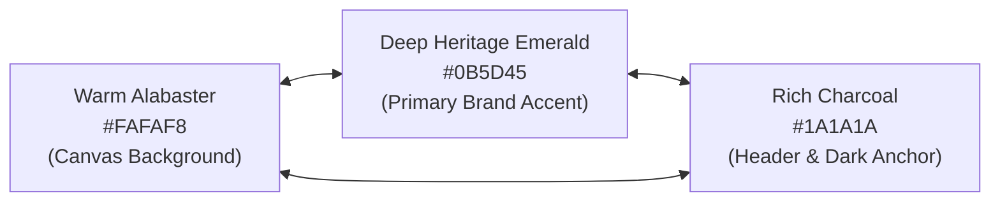
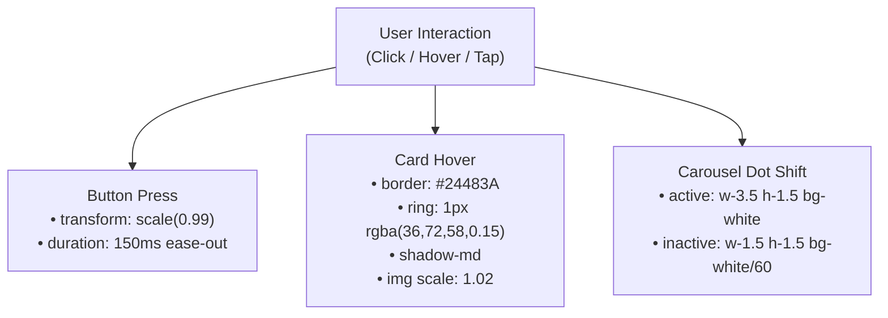

# Ilé — Brand Identity, Design System & UI/UX Philosophy

> **Document Purpose:** The definitive brand identity guide, CSS design token dictionary, and UI/UX design philosophy for the Ilé platform. This document defines the visual language, typography, color architecture, motion principles, and tone of voice required to build or replicate pixel-perfect interfaces across web, mobile, and print.

---

## Table of Contents
1. [Brand Origin & Design Philosophy](#1-brand-origin--design-philosophy)
2. [Exact Color Palette & Token Architecture](#2-exact-color-palette--token-architecture)
3. [Typography System & Hierarchical Scale](#3-typography-system--hierarchical-scale)
4. [Spacing, Layout Grids & Elevation](#4-spacing-layout-grids--elevation)
5. [Component Design System & CSS Classes](#5-component-design-system--css-classes)
6. [Motion, Physics & Micro-Interactions](#6-motion-physics--micro-interactions)
7. [Tone of Voice & UX Writing Rules](#7-tone-of-voice--ux-writing-rules)
8. [Dark Header & Multi-Workspace Contrast Rules](#8-dark-header--multi-workspace-contrast-rules)
9. [Tailwind CSS Complete Master Configuration](#9-tailwind-css-complete-master-configuration)

---

## 1. Brand Origin & Design Philosophy

### 1.1 The Meaning of "Ilé"
**Ilé** (pronounced *ee-lay*) is the Yoruba word for **"Home"**, **"Shelter"**, or **"Sanctuary"**. 

In Nigerian culture, home is not merely four walls—it is a sacred haven of hospitality (*omoluwabi*), safety, dignity, and restorative warmth. Ilé curates boutique, architecture-first short-let homes across Nigeria's prime districts (Maitama, Asokoro, Wuse 2, Jabi in Abuja; Ikoyi, Victoria Island, Lekki Phase 1 in Lagos).

```
   ┌────────────────────────────────────────────────────────┐
   │                                                        │
   │    I L É  •                                            │
   │                                                        │
   │    Boutique Stays & Architectural Havens in Nigeria    │
   │                                                        │
   └────────────────────────────────────────────────────────┘
```

### 1.2 Five Core Design Tenets

#### 1. Boutique Architectural Restraint (Anti-Generic / Anti-SaaS)
Ilé rejects the generic, homogenized "startup SaaS" look—no gratuitous purple/cyan gradient blobs, no floating neon orbs, and no excessive glassmorphism. Interfaces are grounded in tactile materials: warm limestone, dark tropical woods, brushed brass, and crisp gallery typography.

#### 2. Warm Alabaster Over Sterile White
Sterile `#FFFFFF` canvas backgrounds can strain the eyes and feel clinical. Ilé uses a warm alabaster/linen canvas (`#FAFAF8`) contrasted against pure white cards (`#FFFFFF`) and dark charcoal anchor points (`#1A1A1A`).

#### 3. Radical Infrastructure Trust
Short-lets in Nigeria face unique infrastructural hurdles (intermittent municipal electricity, municipal water pressure variance, internet outages). The design makes infrastructure guarantees prominent through dedicated badges and specifications:
- **Power:** "24/7 Solar + Inverter Guaranteed" or "Dual Silent Generator"
- **Internet:** "Starlink High-Speed Satellite" or "Dedicated Fiber Broadband"
- **Security:** "Uniformed Security Gate Guard + 24/7 CCTV"
- **Water:** "Industrial Borehole with Reverse Osmosis Filtration"

#### 4. Quiet Luxury Typography
The pairing of an editorial serif (**DM Serif Display**) with an ultra-legible, geometric sans-serif (**Plus Jakarta Sans**) conveys boutique luxury without pompous clutter.

#### 5. Optical Balance & Border Craft
Every border is intentional. Instead of generic heavy borders or nested card borders, Ilé uses subtle warm stone dividers (`#E7E5E0`, `#F0EFEA`) and hair-thin focus rings with optical inset scaling (`active:scale-[0.99]`).

---

## 2. Exact Color Palette & Token Architecture

All colors are extracted from the platform's production codebase (`globals.css` and `tailwind.config.ts`).

### 2.1 The Core Triad



### 2.2 Complete Color Token Specification

| Token Name | Hex Code | RGB | Tailwind Class | Semantic Purpose |
|---|---|---|---|---|
| **Canvas Background** | `#FAFAF8` | `rgb(250, 250, 248)` | `bg-background` | Universal app background (warm linen/alabaster) |
| **Surface Pure** | `#FFFFFF` | `rgb(255, 255, 255)` | `bg-surface` / `bg-white` | Card backgrounds, modals, input containers |
| **Surface Muted** | `#F5F5F3` | `rgb(245, 245, 243)` | `bg-surface-muted` | Inset backgrounds, secondary tags, code blocks |
| **Charcoal Dark** | `#1A1A1A` | `rgb(26, 26, 26)` | `bg-charcoal` | Global sticky header, dark modal anchors |
| **Charcoal Surface** | `#222222` | `rgb(34, 34, 34)` | `bg-charcoal-surface` | Dropdown menus, header cards |
| **Charcoal Border** | `#2E2E2E` | `rgb(46, 46, 46)` | `border-charcoal-border` | Sub-dividers inside dark headers |
| **Charcoal Hover** | `#282828` | `rgb(40, 40, 40)` | `hover:bg-charcoal-hover` | Interactive state for dark header items |
| **Emerald Accent (Primary)** | `#0B5D45` | `rgb(11, 93, 69)` | `text-emerald` / `bg-emerald` | Primary buttons, verified badges, logo dot |
| **Emerald Hover** | `#084936` | `rgb(8, 73, 54)` | `hover:bg-emerald-hover` | Button hover and pressed states |
| **Emerald Light (Tint)** | `#EDF5F2` | `rgb(237, 245, 242)` | `bg-emerald-light` | Pill tag backgrounds, selection backgrounds |
| **Brand Primary (Deep Pine)**| `#1C3D32` | `rgb(28, 61, 50)` | `bg-brand-primary` | Deep button variants, active state borders |
| **Brand Hover** | `#152E26` | `rgb(21, 46, 38)` | `hover:bg-brand-hover` | Deep button hover state |
| **Foreground Main** | `#171717` | `rgb(23, 23, 23)` | `text-primary` / `text-[#171717]` | Primary headlines, property titles, prices |
| **Foreground Secondary** | `#6B6B67` | `rgb(107, 107, 103)` | `text-primary-secondary` | Subheadings, locations, secondary labels |
| **Foreground Muted** | `#8B8B86` | `rgb(139, 139, 134)` | `text-primary-muted` | Review counts, timestamps, disabled text |
| **Border Default** | `#E7E5E0` | `rgb(231, 229, 224)` | `border-border` | Standard card borders, container outlines |
| **Border Subtle** | `#F0EFEA` | `rgb(240, 239, 234)` | `border-border-subtle` | Subtle section dividers, inner card lines |
| **Border Light** | `#E5E7EB` | `rgb(229, 231, 235)` | `border-border-light` | Form control default borders |

### 2.3 Semantic Status Tokens

| Status | Background | Text | Border | Use Case |
|---|---|---|---|---|
| **Success** | `#EDF5F2` | `#0B5D45` | `#D1E5DE` | Verified host badge, confirmed booking, paid status |
| **Warning / Pending** | `#FEF7ED` | `#9A5B13` | `#FCE8CF` | Payment pending, unverified email, draft listing |
| **Info / Scheduled** | `#F0F6FC` | `#1B65C5` | `#CDE1F3` | Upcoming arrival, calendar lock, policy update |
| **Critical / Error** | `#FDF2F2` | `#B91C1C` | `#F8D7D7` | Form validation error, rejected KYC, cancelled stay |

### 2.4 CSS Custom Properties (`:root`)

```css
:root {
  --font-sans: "Plus Jakarta Sans", system-ui, -apple-system, BlinkMacSystemFont, "Segoe UI", Roboto, sans-serif;
  --font-display: "DM Serif Display", Georgia, Cambria, serif;

  --background: #FAFAF8;
  --surface: #FFFFFF;
  --surface-muted: #F5F5F3;
  --surface-elevated: #FFFFFF;

  --foreground: #171717;
  --foreground-secondary: #6B6B67;
  --foreground-muted: #8B8B86;

  --border: #E7E5E0;
  --border-subtle: #F0EFEA;
  --border-light: #E5E7EB;
  --placeholder: #9CA3AF;

  --accent: #0B5D45;
  --accent-hover: #084936;
  --accent-light: #EDF5F2;
  --brand-primary: #1C3D32;
  --brand-hover: #152E26;

  /* Semantic Status */
  --status-success-bg: #EDF5F2;
  --status-success-text: #0B5D45;
  --status-success-border: #D1E5DE;

  --status-warning-bg: #FEF7ED;
  --status-warning-text: #9A5B13;
  --status-warning-border: #FCE8CF;

  --status-info-bg: #F0F6FC;
  --status-info-text: #1B65C5;
  --status-info-border: #CDE1F3;

  --status-critical-bg: #FDF2F2;
  --status-critical-text: #B91C1C;
  --status-critical-border: #F8D7D7;
}
```

---

## 3. Typography System & Hierarchical Scale

### 3.1 Font Families

```
   ┌─────────────────────────────────────────────────────────────┐
   │  DISPLAY / SERIF:                                           │
   │  DM Serif Display                                           │
   │  "Refined, architectural elegance with Nigerian warmth"     │
   ├─────────────────────────────────────────────────────────────┤
   │  BODY & UI / SANS:                                          │
   │  Plus Jakarta Sans (300, 400, 500, 600, 700)               │
   │  "Crisp, contemporary geometric clarity and legibility"     │
   └─────────────────────────────────────────────────────────────┘
```

1. **Display Serif (`var(--font-display)`):**
   - Family: `DM Serif Display`, Georgia, serif
   - Weight: Regular (`400`)
   - Usage: Brand wordmark ("Ilé"), Hero headlines, Destination showcase titles, Section editorial headers.
2. **Body & Interface Sans (`var(--font-sans)`):**
   - Family: `Plus Jakarta Sans`, -apple-system, sans-serif
   - Weights: Light (`300`), Regular (`400`), Medium (`500`), Semi-bold (`600`), Bold (`700`)
   - Usage: Navigation links, property card titles, pricing numerals, form inputs, metadata, and body copy.

### 3.2 Mathematical Type Scale

| Role | Font Family | Size (Desktop) | Size (Mobile) | Line Height | Tracking | Weight | Example |
|---|---|---|---|---|---|---|---|
| **Display XXL** | DM Serif Display | `3.75rem` (60px) | `2.5rem` (40px) | `1.1` | `-0.02em` | `400` | "Find your sanctuary in Nigeria" |
| **Display XL** | DM Serif Display | `2.5rem` (40px) | `1.875rem` (30px) | `1.15` | `-0.02em` | `400` | "Curated Stays in Maitama" |
| **H1 (Section)**| DM Serif Display | `1.875rem` (30px) | `1.5rem` (24px) | `1.2` | `-0.015em` | `400` | "Popular Neighborhoods" |
| **H2 (Card)** | Plus Jakarta Sans | `1.125rem` (18px) | `1.0625rem` (17px) | `1.3` | `-0.01em` | `600` | "Maitama Heights Executive Suite" |
| **Price Hero**| Plus Jakarta Sans | `1.25rem` (20px) | `1.125rem` (18px) | `1.2` | `-0.02em` | `700` | "₦180,000 / night" |
| **Body Base** | Plus Jakarta Sans | `0.9375rem` (15px) | `0.9375rem` (15px) | `1.55` | `0` | `400` / `500`| Property description copy |
| **Body Small**| Plus Jakarta Sans | `0.875rem` (14px) | `0.8125rem` (13px) | `1.45` | `0` | `400` / `500`| Form helper text, address copy |
| **Micro Tag** | Plus Jakarta Sans | `0.6875rem` (11px) | `0.6875rem` (11px) | `1.2` | `+0.05em` | `700` (Caps)| "VERIFIED STAY", "CHECK-IN" |

---

## 4. Spacing, Layout Grids & Elevation

### 4.1 The 4px / 8px Spacing Grid
All paddings and margins derive from an 8pt base grid with a 4pt sub-grid:

| Token | Pixels | Rem | Typical Application |
|---|---|---|---|
| `p-1` | 4px | `0.25rem` | Icon gaps, tight tag padding |
| `p-2` | 8px | `0.5rem` | Badge padding, micro buttons |
| `p-3` | 12px | `0.75rem` | Card internal gutters, date step controls |
| `p-4` | 16px | `1rem` | Standard mobile container padding |
| `p-5` | 20px | `1.25rem` | Booking widget padding |
| `p-6` | 24px | `1.5rem` | Modal container padding |
| `p-8` | 32px | `2rem` | Section gutters |
| `p-12`| 48px | `3rem` | Large display containers |
| `py-16`| 64px | `4rem` | Section vertical rhythm |

### 4.2 Border Radius Hierarchy

```
   ┌─────────────────────────────────────────────────────────────┐
   │  rounded-full (9999px)    ── Pills, Badges, Avatar Circles  │
   │  rounded-[18px]           ── Property & Destination Cards   │
   │  rounded-2xl (16px)       ── Booking Widget, Sticky Panel   │
   │  rounded-[13px]           ── Card Photo Inner Boundary      │
   │  rounded-lg (8px-10px)    ── Buttons, Form Input Fields     │
   └─────────────────────────────────────────────────────────────┘
```

### 4.3 Tactile Elevation & Box Shadows
Ilé uses diffuse, low-contrast shadows that resemble natural overhead daylight:

```css
/* Subtle Elevation (Property Cards, Floating Badges) */
.shadow-xs {
  box-shadow: 0 1px 2px 0 rgba(0, 0, 0, 0.05);
}

/* Card Hover Elevation */
.shadow-sm {
  box-shadow: 0 1px 3px 0 rgba(0, 0, 0, 0.08), 0 1px 2px -1px rgba(0, 0, 0, 0.08);
}

/* Active Hover Card (Lift Effect) */
.shadow-md {
  box-shadow: 0 4px 6px -1px rgba(0, 0, 0, 0.07), 0 2px 4px -2px rgba(0, 0, 0, 0.05);
}

/* Bottom Sheet / Modal Scrim */
.shadow-xl {
  box-shadow: 0 20px 25px -5px rgba(0, 0, 0, 0.1), 0 8px 10px -6px rgba(0, 0, 0, 0.1);
}
```

---

## 5. Component Design System & CSS Classes

### 5.1 The Brand Logo & Mark

```html
<!-- Brand Wordmark with Emerald Accent Dot -->
<a href="/" class="flex items-center gap-2 group">
  <span class="font-display text-2xl sm:text-3xl tracking-tight text-white font-normal">
    Ilé
  </span>
  <span class="w-2 h-2 rounded-full bg-[#0B5D45] mt-1 group-hover:scale-125 transition-transform" />
</a>
```

### 5.2 Primary & Secondary Buttons

```css
/* Primary Action Button (.ile-btn-primary) */
.ile-btn-primary {
  height: 44px; /* 2.75rem - ergonomic touch target */
  padding: 0 1.5rem;
  border-radius: 8px;
  background-color: #065F46; /* Deep Emerald */
  color: #FFFFFF;
  font-size: 0.875rem;
  font-weight: 600;
  display: inline-flex;
  align-items: center;
  justify-content: center;
  gap: 0.5rem;
  transition: background-color 150ms ease-out, transform 150ms ease-out, box-shadow 150ms ease-out;
  cursor: pointer;
}

.ile-btn-primary:hover:not(:disabled) {
  background-color: #044E39;
}

.ile-btn-primary:active:not(:disabled) {
  transform: scale(0.99);
  background-color: #044E39;
}

.ile-btn-primary:disabled {
  opacity: 0.5;
  cursor: not-allowed;
}

/* Secondary Neutral Button (.ile-btn-secondary) */
.ile-btn-secondary {
  height: 44px;
  padding: 0 1.25rem;
  border-radius: 8px;
  border: 1px solid #E5E7EB;
  background-color: #FFFFFF;
  color: #4B5563;
  font-size: 0.875rem;
  font-weight: 500;
  display: inline-flex;
  align-items: center;
  justify-content: center;
  gap: 0.5rem;
  transition: border-color 150ms ease-out, background-color 150ms ease-out, color 150ms ease-out, transform 150ms ease-out;
  cursor: pointer;
}

.ile-btn-secondary:hover:not(:disabled) {
  border-color: #9CA3AF;
  background-color: #FAFAF8;
  color: #111827;
}

.ile-btn-secondary:active:not(:disabled) {
  transform: scale(0.99);
}
```

### 5.3 Form Inputs & Fields

```css
/* Premium Form Control (.ile-input) */
.ile-input {
  width: 100%;
  height: 44px;
  padding: 0 0.875rem;
  background-color: #FFFFFF;
  border: 1px solid #D1D5DB;
  border-radius: 8px;
  font-size: 0.875rem;
  color: #111827;
  outline: none;
  transition: border-color 150ms ease-out, box-shadow 150ms ease-out;
}

.ile-input::placeholder {
  color: #9CA3AF;
}

.ile-input:hover:not(:disabled):not(:focus) {
  border-color: #9CA3AF;
}

.ile-input:focus {
  border-color: #065F46;
  box-shadow: 0 0 0 2px rgba(6, 95, 70, 0.15);
}

.ile-input.error {
  border-color: #F87171;
  color: #881337;
}

.ile-input.error:focus {
  border-color: #EF4444;
  box-shadow: 0 0 0 2px rgba(239, 68, 68, 0.15);
}
```

### 5.4 Property Cards & Gallery Scrims
Every property listing card follows an exact spatial formula:
- **Card Outer Container:** `bg-white rounded-[18px] border border-[#EAE8E3] p-3.5`
- **Inner Image Gallery:** `aspect-[16/10] rounded-[13px] overflow-hidden bg-[#E7E5E0]`
- **Targeted Bottom Scrim Gradient:**
  ```css
  background: linear-gradient(to top, rgba(0, 0, 0, 0.90) 0%, rgba(0, 0, 0, 0.55) 45%, transparent 70%);
  ```
  *(Locks contrast to text without muddying the sky or property architecture).*
- **Verified Stay Pill Badge:**
  ```html
  <div className="absolute top-3 left-3 bg-white/95 backdrop-blur-sm px-2.5 py-0.5 rounded-full text-[11.5px] font-semibold text-[#171717] border border-[#E7E5E0]/60 shadow-xs">
    Verified stay
  </div>
  ```

---

## 6. Motion, Physics & Micro-Interactions

Ilé adheres to strict motion restraint. Animations must feel mechanical and tactile, never floaty or whimsical.



### 6.1 Transition Presets
- **State transitions:** `150ms cubic-bezier(0.16, 1, 0.3, 1)` (ease-out).
- **Image zoom on card hover:** `duration-500 ease-out group-hover:scale-[1.02]`.
- **Modal backdrop fade:** `duration-200 ease-out opacity-100`.

### 6.2 Haptic Cues on Mobile
- Date picker step shift $\rightarrow$ light impact haptic.
- Booking confirmation $\rightarrow$ notification success haptic.
- Paystack modal trigger $\rightarrow$ medium impact haptic.

---

## 7. Tone of Voice & UX Writing Rules

### 7.1 Brand Persona
- **Cultured & Architectural:** Celebrates high-end Nigerian design (from modern brutalism in Guzape to contemporary Afro-minimalism in Victoria Island).
- **Discreet & Secure:** Reassuring, dependable, and precise regarding security and payment locks.
- **Unpretentious Warmth:** Hospitable and warm without relying on flowery adjectives or hyperbolic tech jargon.

### 7.2 Writing Guardrails

| Never Use (Generic / AI Slop) | Always Use (Ilé Voice) | Context / Reason |
|---|---|---|
| "Welcome to the ultimate luxury oasis!" | "Private 3-bedroom penthouse with dedicated solar power." | Grounded in architectural fact, not fluff |
| "Unlock limitless potential in short stays" | "Verified boutique stays in Maitama and Ikoyi." | Concrete geographic destinations |
| "Failed! An unexpected error occurred" | "We couldn't verify this bank account. Please check the 10-digit NUBAN." | Clear, actionable instructions |
| "Pay now to see address" | "Property address and gate codes are released upon confirmed payment." | Respectful, security-focused explanation |
| "Cheap apartments in Lagos" | "Curated serviced residences in Lagos." | Preserves luxury boutique positioning |

---

## 8. Dark Header & Multi-Workspace Contrast Rules

Ilé implements a dual-contrast architectural model:

```
   ┌─────────────────────────────────────────────────────────────┐
   │  HEADER (Anchored Deep Charcoal):                           │
   │  Background: #1A1A1A  |  Border: #2A2A2A  |  Text: #FFFFFF  │
   ├─────────────────────────────────────────────────────────────┤
   │  MAIN CANVAS (Warm Linen / Alabaster):                      │
   │  Background: #FAFAF8  |  Cards: #FFFFFF   |  Text: #171717  │
   ├─────────────────────────────────────────────────────────────┤
   │  ADMIN / HOST WORKSPACE:                                    │
   │  Background: #F4F4F1  |  Borders: #E5E4DE |  Accent: Gold   │
   └─────────────────────────────────────────────────────────────┘
```

1. **Sticky Header Contrast:** The header remains `#1A1A1A` with a `#2A2A2A` bottom divider across all public marketplace routes. This gives users an authoritative anchor point while browsing light, spacious properties.
2. **Interactive State Feedback:** Links in the dark header transition from `#DCDCDA` to `#FFFFFF` with a bottom indicator pill (`bg-[#0B5D45]` for hosts, `bg-amber-400` for admins).
3. **Selection Highlighting:** When text is selected anywhere on the site:
   ```css
   ::selection {
     background-color: #EDF3F0;
     color: #24483A;
   }
   ```

---

## 9. Tailwind CSS Complete Master Configuration

Here is the authoritative `tailwind.config.ts` matching the Ilé design system:

```typescript
import type { Config } from "tailwindcss";

const config: Config = {
  content: [
    "./src/pages/**/*.{js,ts,jsx,tsx,mdx}",
    "./src/components/**/*.{js,ts,jsx,tsx,mdx}",
    "./src/app/**/*.{js,ts,jsx,tsx,mdx}",
  ],
  theme: {
    extend: {
      colors: {
        background: "#FAFAF8",
        surface: {
          DEFAULT: "#FFFFFF",
          muted: "var(--surface-muted)",
          elevated: "var(--surface-elevated)",
        },
        charcoal: {
          DEFAULT: "#1A1A1A",
          surface: "#222222",
          border: "#2E2E2E",
          hover: "#282828",
        },
        emerald: {
          DEFAULT: "#0B5D45",
          hover: "#084936",
          light: "#EDF5F2",
        },
        primary: {
          DEFAULT: "#171717",
          secondary: "#6B6B67",
          muted: "#8B8B86",
        },
        border: {
          DEFAULT: "#E7E5E0",
          subtle: "#F0EFEA",
        },
        accent: {
          DEFAULT: "#0B5D45",
          hover: "#084936",
          light: "#EDF5F2",
          surface: "#F4F7F5",
        },
        status: {
          success: {
            bg: "var(--status-success-bg)",
            text: "var(--status-success-text)",
            border: "var(--status-success-border)",
          },
          warning: {
            bg: "var(--status-warning-bg)",
            text: "var(--status-warning-text)",
            border: "var(--status-warning-border)",
          },
          info: {
            bg: "var(--status-info-bg)",
            text: "var(--status-info-text)",
            border: "var(--status-info-border)",
          },
          critical: {
            bg: "var(--status-critical-bg)",
            text: "var(--status-critical-text)",
            border: "var(--status-critical-border)",
          },
        },
      },
      fontFamily: {
        sans: ["var(--font-sans)", "Plus Jakarta Sans", "system-ui", "-apple-system", "sans-serif"],
        display: ["var(--font-display)", "DM Serif Display", "Georgia", "serif"],
        serif: ["var(--font-display)", "DM Serif Display", "Georgia", "serif"],
      },
      spacing: {
        "18": "4.5rem",
        "88": "22rem",
        "112": "28rem",
        "128": "32rem",
      },
      borderRadius: {
        subtle: "10px",
        card: "18px",
        inner: "13px",
      },
      boxShadow: {
        xs: "0 1px 2px 0 rgba(0, 0, 0, 0.05)",
      },
    },
  },
  plugins: [],
};

export default config;
```

---

*This document establishes the official branding, visual design, and UI token architecture for the Ilé platform. For technical endpoint specifications and ledger implementations, refer to [`backend.md`](file:///c:/Users/user/Desktop/NEXT_HOME/backend.md) and [`mobile.md`](file:///c:/Users/user/Desktop/NEXT_HOME/mobile.md).*
