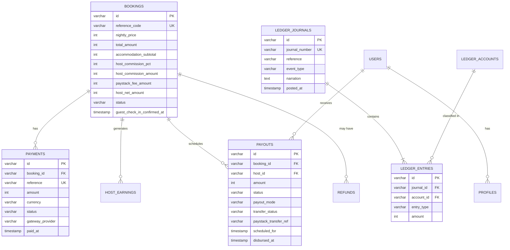
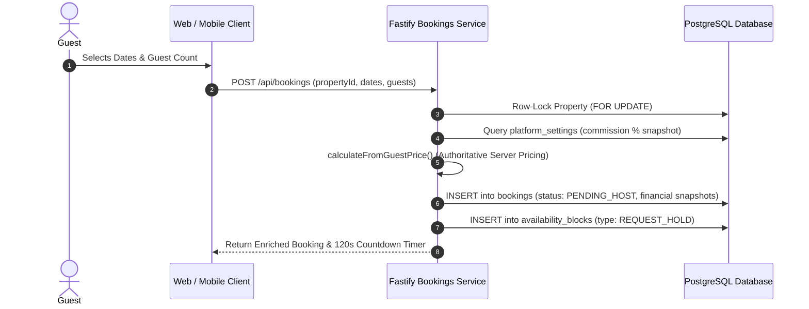
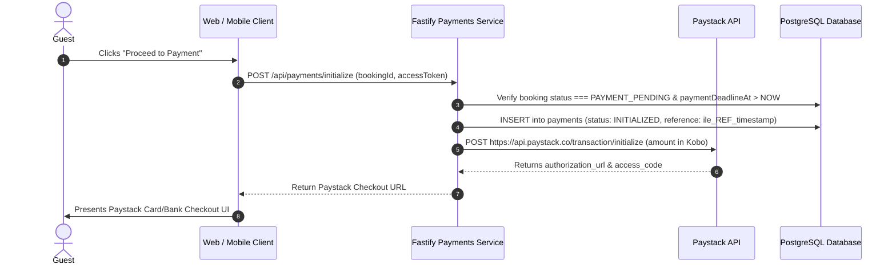
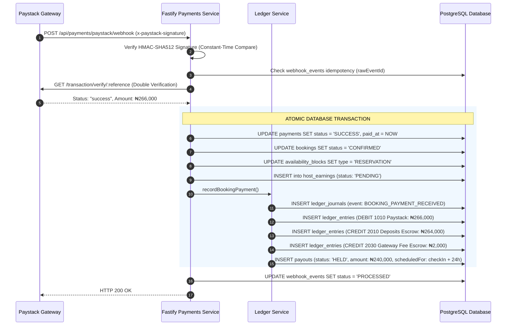
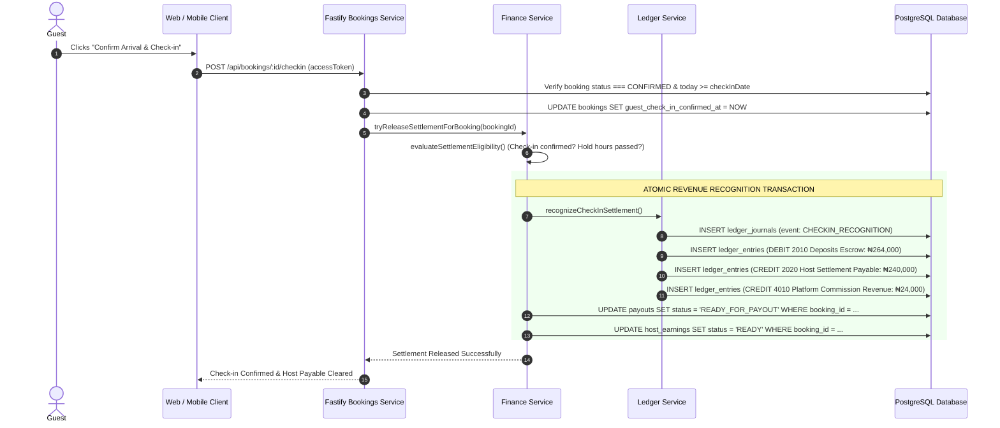
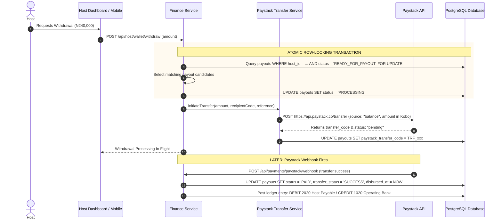

# Ilé Accommodation Marketplace — Finance System Architecture, End-to-End Flow & Implementation Guide

**Document Version:** 1.0.0-PROD-FINANCE  
**Date:** November 23, 2026  
**Audience:** Core Engineers, Solutions Architects, Financial Controllers & Auditors  
**File Location:** `docs/finance/README.md`

---

## Table of Contents

1. [Executive Architecture Overview](#1-executive-architecture-overview)
2. [Core Financial Mathematics & Pricing Engine](#2-core-financial-mathematics--pricing-engine)
3. [Chart of Accounts & Double-Entry General Ledger](#3-chart-of-accounts--double-entry-general-ledger)
4. [Database Schemas & Data Model](#4-database-schemas--data-model)
5. [End-to-End Financial Lifecycle & Sequence Workflows](#5-end-to-end-financial-lifecycle--sequence-workflows)
   - [Phase 1: Booking Pricing & Reservation Snapshot](#phase-1-booking-pricing--reservation-snapshot)
   - [Phase 2: Payment Gateway Initialization & Collection](#phase-2-payment-gateway-initialization--collection)
   - [Phase 3: Payment Verification & Escrow Journaling](#phase-3-payment-verification--escrow-journaling)
   - [Phase 4: Stay Arrival & Revenue Recognition](#phase-4-stay-arrival--revenue-recognition)
   - [Phase 5: Host Wallet Balance Projection](#phase-5-host-wallet-balance-projection)
   - [Phase 6: Host Payout Settlement & Bank Transfers](#phase-6-host-payout-settlement--bank-transfers)
   - [Phase 7: Cancellations, Refunds & Late Payment Reconciliation](#phase-7-cancellations-refunds--late-payment-reconciliation)
6. [Settlement Modes: Manual vs Automatic](#6-settlement-modes-manual-vs-automatic)
7. [Implementation Deep Dive & Code Directory](#7-implementation-deep-dive--code-directory)
8. [Security, Concurrency & Transaction Boundaries](#8-security-concurrency--transaction-boundaries)
9. [Edge Cases & Error Recovery](#9-edge-cases--error-recovery)
10. [Automated Verification & Operational Monitoring](#10-automated-verification--operational-monitoring)

---

## 1. Executive Architecture Overview

The Ilé accommodation marketplace financial engine is an institutional-grade, double-entry financial system tailored for the Nigerian short-let accommodation sector. Operating natively in Nigerian Naira (₦ / NGN), the architecture guarantees:

1. **Strict Double-Entry Bookkeeping:** Every financial mutation (guest payment, escrow hold, check-in revenue recognition, host payout, and guest refund) is posted to a balanced general ledger journal where Total Debits strictly equal Total Credits ($\sum \text{Debits} \equiv \sum \text{Credits}$).
2. **Authoritative Server-Side Pricing:** Pricing is never accepted from client payloads. The backend calculates nightly accommodations, platform commissions, and gateway pass-through fees authoritatively from database property records.
3. **Escrow Liability Protection:** Guest funds are treated as an escrow liability (`2010 Advance Guest Deposits`) upon payment. Platform commission revenue is **never recognized upon payment**; it is recognized only when the guest physically checks in to the property (`CHECKIN_RECOGNITION`).
4. **Dynamic Ledger Projection (No Balance Drift):** There is no mutable `host_balance` table prone to race conditions or balance drift. Host wallet balances (`pending`, `available`, `processing`, `paid`) are real-time SQL ledger projections derived directly from payout row states.
5. **Dual Payout Orchestration:** Supports both a risk-managed **Manual Approval Mode** (funds held until check-in + 24-hour hold duration) and a configurable **Automatic Mode** (instant payout release for verified hosts).
6. **Paystack Gateway Integration:** Full-lifecycle integration with Paystack's official APIs for payment initialization, transaction verification, HMAC-SHA512 webhook ingestion, recipient bank account resolution, and automated NUBAN transfers.

---

## 2. Core Financial Mathematics & Pricing Engine

All financial calculations originate in [`backend/src/modules/pricing/pricing.service.ts`](file:///c:/Users/user/Desktop/NEXT_HOME/backend/src/modules/pricing/pricing.service.ts).

### 2.1 The Two-Tier Pricing Formula

Ilé distinguishes between the **Host Base Nightly Price** (what the property owner intends to earn per night) and the **Guest Nightly Price** (what the marketplace displays and charges).

$$\text{Guest Nightly Price} = \text{round}\Big(\text{Host Base Nightly Price} \times (1 + \text{Commission Rate})\Big)$$

$$\text{Accommodation Subtotal} = \text{Guest Nightly Price} \times \text{Number of Nights}$$

$$\text{Host Classic Earnings} = \text{Host Base Nightly Price} \times \text{Number of Nights}$$

$$\text{Platform Commission} = \text{Accommodation Subtotal} - \text{Host Classic Earnings}$$

- **Default Commission Rate:** 10% (`0.10`), configurable dynamically by platform administrators via the `platform_settings` table.
- **Embedded Commission Rule:** The platform commission is baked directly into the nightly display price. Guests never see a separate "service fee" or "commission" line item at checkout.

### 2.2 Paystack Pass-Through Fee Formula

Paystack charges an official domestic processing fee of **1.5% + ₦100**, with the ₦100 flat fee waived for micro-transactions under ₦2,500, and capped at an absolute ceiling of **₦2,000**.

Verified in `pricing.service.ts#L11-L20`:

$$\text{Paystack Fee} = \begin{cases} 
0 & \text{if } \text{Subtotal} \le 0 \\
\min\left(2000, \left\lceil \frac{\text{Subtotal}}{0.985} \right\rceil - \text{Subtotal}\right) & \text{if } \text{Subtotal} < 2500 \\
\min\left(2000, \left\lceil \frac{\text{Subtotal} + 100}{0.985} \right\rceil - \text{Subtotal}\right) & \text{if } \text{Subtotal} \ge 2500
\end{cases}$$

$$\text{Total Guest Payment} = \text{Accommodation Subtotal} + \text{Paystack Fee}$$

### 2.3 Transparent Fee Invariants

- **Cleaning Fee:** Strictly `0` (`cleaningFee: 0`). No unapproved cleaning fees are added.
- **Service Fee:** Set equal to the exact Paystack domestic pass-through fee (`serviceFee: paystackFee`).
- **Authoritative Booking Snapshot:** When a booking is created (`bookings.service.ts#L281-L333`), all calculated financial values are snapshotted permanently into the `bookings` record:
  - `accommodationSubtotal`
  - `hostCommissionPct`
  - `hostCommissionAmount`
  - `paystackFeeAmount`
  - `hostNetAmount`
  - `hostPayoutPct`
  - `totalAmount`
- **Historical Integrity:** If an administrator subsequently alters the platform commission rate or payout hold hours in `platform_settings`, existing and historical bookings retain their original snapshot values and are never retroactively recalculated.

---

## 3. Chart of Accounts & Double-Entry General Ledger

Implemented in [`backend/src/modules/finance/ledger.service.ts`](file:///c:/Users/user/Desktop/NEXT_HOME/backend/src/modules/finance/ledger.service.ts) and backed by [`backend/src/db/schema/finance.ts`](file:///c:/Users/user/Desktop/NEXT_HOME/backend/src/db/schema/finance.ts).

### 3.1 Standard Chart of Accounts

| Account Code | Account Name | Type | Purpose / Description | Normal Balance |
|:---:|:---|:---:|:---|:---:|
| **1010** | **Paystack Clearing** | ASSET | Clearing account holding unsettled funds collected by Paystack gateway. | Debit |
| **1020** | **Operating Bank Account** | ASSET | Corporate bank account from which manual or bank payouts are funded. | Debit |
| **2010** | **Advance Guest Deposits** | LIABILITY | Escrow liability account holding unearned guest stay funds until check-in. | Credit |
| **2020** | **Host Settlement Payable** | LIABILITY | Withdrawable debt owed to hosts after stay check-in has been recognized. | Credit |
| **2030** | **Paystack Fee Escrow** | LIABILITY | Pass-through liability holding collected Paystack transaction charges. | Credit |
| **4010** | **Platform Commission Revenue** | REVENUE | Earned Ilé commission revenue, recognized strictly upon guest check-in. | Credit |
| **5010** | **Payment Processing Expense** | EXPENSE | Gateway fees recognized when transactions are settled or refunded. | Debit |
| **5020** | **Payout Transfer Fee** | EXPENSE | Bank transfer fees incurred when disbursing payouts to host accounts. | Debit |

### 3.2 The Four Lifecycle Journal Events

```
1. Guest Pays for Stay:
   DEBIT   1010 Paystack Clearing              (Total Amount)
   CREDIT  2010 Advance Guest Deposits         (Accommodation Subtotal)
   CREDIT  2030 Paystack Fee Escrow            (Paystack Processing Fee)

2. Guest Checks In (Arrival Confirmed):
   DEBIT   2010 Advance Guest Deposits         (Accommodation Subtotal)
   CREDIT  2020 Host Settlement Payable        (Host Net Earnings)
   CREDIT  4010 Platform Commission Revenue    (Platform Commission)

3. Host Payout Disbursed:
   DEBIT   2020 Host Settlement Payable        (Payout Amount)
   CREDIT  1020 Operating Bank Account         (Payout Amount)

4. Stay Refund Confirmed:
   DEBIT   2010 Advance Guest Deposits         (Refundable Accommodation)
   CREDIT  1010 Paystack Clearing              (Refundable Accommodation)
   (Non-refundable gateway fees are recognized as expense: 2030 -> 5010)
```

### 3.3 Zero-Sum Balancing Engine

In `LedgerService.postJournalEntry` (`ledger.service.ts#L62-L131`), every journal posting executes an in-memory summation:

```typescript
let totalDebits = 0;
let totalCredits = 0;

for (const entry of entries) {
  if (entry.entryType === "DEBIT") totalDebits += entry.amount;
  else if (entry.entryType === "CREDIT") totalCredits += entry.amount;
}

if (totalDebits !== totalCredits) {
  throw new Error(`Double-entry imbalance detected: Total Debits (₦${totalDebits}) !== Total Credits (₦${totalCredits})`);
}
```

If an imbalance of even ₦1 occurs, the database transaction rolls back immediately, preventing unverified or corrupt postings.

---

## 4. Database Schemas & Data Model

The financial data architecture is defined across four core schema modules in `backend/src/db/schema/`:



### 4.1 Schema Definitions & File Map

1. **General Ledger Tables (`backend/src/db/schema/finance.ts`):**
   - `ledger_accounts`: Definitions of accounts 1010–5020.
   - `ledger_journals`: Immutable audit record of journal events with timestamps, reference codes, and narrations.
   - `ledger_entries`: Debits and credits linked to journal headers with foreign key constraints.
   - `host_earnings`: Historical earnings snapshot table per booking.
   - `payouts`: Actionable settlement rows tracking payout status (`HELD`, `READY_FOR_PAYOUT`, `PROCESSING`, `PAID`, `CANCELLED`).
   - `refunds`: Refund requests and Paystack execution tracking (`REQUESTED`, `APPROVED`, `PROCESSED`, `REJECTED`, `FAILED`).
2. **Payment Tracking (`backend/src/db/schema/payments.ts`):**
   - `payments`: Raw transaction records with Paystack reference, authorization code, and payload.
   - `webhook_events`: Ingested Paystack webhook event store enforcing idempotency (`status: PENDING | PROCESSED | FAILED`).
3. **Platform Settings (`backend/src/db/schema/settings.ts`):**
   - `platform_settings`: Global financial parameters (`defaultHostCommissionPct: 10`, `hostPayoutMode: MANUAL | AUTOMATIC`, `payoutHoldHours: 24`).

---

## 5. End-to-End Financial Lifecycle & Sequence Workflows

### Phase 1: Booking Pricing & Reservation Snapshot



### Phase 2: Payment Gateway Initialization & Collection

Once the host accepts the booking (`status: PAYMENT_PENDING`), the guest enters their 10-minute payment window.



### Phase 3: Payment Verification & Escrow Journaling

Verification is triggered either via client redirect callback or via Paystack webhook (`charge.success`). The backend treats Paystack as the sole authority.



### Phase 4: Stay Arrival & Revenue Recognition

Advance guest deposits remain in escrow until check-in. When the guest arrives and confirms check-in (or after the scheduled stay start date in automatic mode), the revenue recognition transaction fires.



### Phase 5: Host Wallet Balance Projection

The host wallet does not query an arbitrary balance number. Instead, `FinanceService.getHostWallet(hostId)` executes a SQL projection over the `payouts` table:

```sql
SELECT
  COALESCE(SUM(CASE WHEN status = 'HELD' THEN amount ELSE 0 END), 0)::int AS pending,
  COALESCE(SUM(CASE WHEN status = 'READY_FOR_PAYOUT' THEN amount ELSE 0 END), 0)::int AS available,
  COALESCE(SUM(CASE WHEN status = 'PROCESSING' THEN amount ELSE 0 END), 0)::int AS processing,
  COALESCE(SUM(CASE WHEN status = 'PAID' THEN amount ELSE 0 END), 0)::int AS paid
FROM payouts
WHERE host_id = :hostId;
```

- **Pending:** Earnings tied to confirmed reservations whose check-in or hold hours have not yet elapsed.
- **Available:** Withdrawable earnings ready for host payout transfer.
- **Processing:** Payouts reserved in an active Paystack transfer batch currently in flight.
- **Paid:** Successfully disbursed funds credited to the host's bank account.

### Phase 6: Host Payout Settlement & Bank Transfers



### Phase 7: Cancellations, Refunds & Late Payment Reconciliation

1. **Guest Cancellation Before Check-In:**
   - Guest requests cancellation via `/api/bookings/:id/cancel`.
   - If unpaid, hold is deleted immediately.
   - If paid, `refunds` row is created with status `REQUESTED` for admin approval.
2. **Admin Refund Authorization (`approveRefund` & `processApprovedRefund`):**
   - Admin approves refund in Admin Console.
   - Fastify calls Paystack Refund API (`POST https://api.paystack.co/refund`).
   - Ledger posts `BOOKING_REFUND_CONFIRMED`:
     - DEBIT 2010 Advance Deposits (₦264,000)
     - CREDIT 1010 Paystack Clearing (₦264,000)
     - Non-refundable gateway fee (₦2,000) is recognized as expense (2030 -> 5010).
   - Associated `payouts` row is updated to `status: 'CANCELLED'` to prevent accidental host payout.
3. **Late Payment Handling (Reconciliation Exception):**
   - If a guest completes payment on Paystack *after* the 10-minute window has expired and the booking has transitioned to `CANCELLED`:
   - `recordLatePaymentForReconciliation` executes (`payments.service.ts#L935-L1056`):
     - Payment record marked `SUCCESS`.
     - Raw payload annotated with `[ILE_LATE_PAYMENT_RECONCILIATION]`.
     - **Booking status is NEVER revived** (remains `CANCELLED`).
     - **No host payout or earnings row is created**.
     - An automated refund row is created in `refunds` with status `REQUESTED`.
     - Alerts dispatched to guest and support admins.

---

## 6. Settlement Modes: Manual vs Automatic

Configured in `platform_settings` table (`host_payout_mode`):

| Feature / Behavior | MANUAL Mode (Default) | AUTOMATIC Mode |
|:---|:---|:---|
| **Revenue Recognition** | Triggered only upon guest check-in arrival confirmation (`guestCheckInConfirmedAt`). | Auto-releases check-in settlement upon verified payment without waiting for check-in. |
| **Payout Queue State** | Payout stays `HELD` until check-in + 24 hours. Moves to `READY_FOR_PAYOUT`. | Payout transitions from `HELD` directly to `READY_FOR_PAYOUT` immediately after payment. |
| **Bank Transfer Trigger** | Requires explicit host withdrawal request or admin batch disbursement. | Immediately invokes Paystack Transfers API (`initiateTransfer`) if host bank is verified. |
| **Fraud & Dispute Exposure** | **Very Low:** Funds protected in escrow. Cancellation/dispute resolved before payout. | **Higher:** Requires trusted, fully vetted hosts with high reputation. |
| **Recommended Use Case** | Default for all standard hosts, new hosts, and general marketplace operations. | Enterprise property management companies and pre-approved superhosts. |

---

## 7. Implementation Deep Dive & Code Directory

### Directory Architecture

```
backend/src/
├── config/
│   └── constants.ts              # Financial limits, session timeouts
├── db/
│   ├── client.ts                 # Database pooler & PGlite fallback
│   └── schema/
│       ├── finance.ts            # Ledger accounts, journals, entries, payouts, refunds
│       ├── bookings.ts           # Bookings table & authoritative financial snapshots
│       ├── payments.ts           # Payments table & webhook audit store
│       └── settings.ts           # Platform settings (commission %, payout mode, hold hours)
├── modules/
│   ├── pricing/
│   │   └── pricing.service.ts    # Pricing formulas, Paystack fees, commission calculation
│   ├── finance/
│   │   ├── ledger.service.ts     # Double-entry posting, journal events, balancing rules
│   │   ├── finance.service.ts    # Wallet projection, payout queues, settlements, refunds
│   │   └── finance.routes.ts     # Fastify admin & host finance endpoints
│   └── payments/
│       ├── payments.service.ts   # Paystack init, verify, webhooks, late payments
│       ├── payments.routes.ts    # Public payment callback & webhook endpoints
│       └── paystack-transfer.service.ts # Paystack NUBAN recipient & transfer integration
```

### Core Service API Method Reference

#### 1. Pricing Engine (`pricing.service.ts`)
- `calculatePaystackFee(subtotal: number): number`
- `getPlatformCommissionRate(): Promise<number>`
- `calculateFromHostBase(hostBasePrice, nights, commissionRate): PricingBreakdown`
- `calculateFromGuestPrice(guestPrice, nights, commissionRate, explicitHostBase): PricingBreakdown`

#### 2. Ledger Engine (`ledger.service.ts`)
- `postJournalEntry(tx, options: PostJournalOptions)`: Strictly validates debits === credits and inserts journal header and entry legs.
- `recordBookingPayment(tx, params)`: Posts `BOOKING_PAYMENT_RECEIVED` journal and schedules `HELD` payout.
- `recognizeCheckInSettlement(tx, params)`: Posts `CHECKIN_RECOGNITION` journal and updates payout to `READY_FOR_PAYOUT`.
- `recordHostPayout(tx, params)`: Posts `HOST_PAYOUT_DISBURSED` journal and marks payout `PAID`.
- `recordBookingRefund(tx, params)`: Posts `BOOKING_REFUND_CONFIRMED` journal and marks payout `CANCELLED`.

#### 3. Finance & Settlement Service (`finance.service.ts`)
- `getHostWallet(hostId: string)`: Returns `{ balances: { pending, available, processing, paid }, bank, payoutMode }`.
- `requestHostWithdrawal(hostId: string, params)`: Row-locks `READY_FOR_PAYOUT` records and transitions them to `PROCESSING`.
- `tryReleaseSettlementForBooking(bookingId, context)`: Evaluates eligibility and calls `recognizeCheckInSettlement`.
- `processDueSettlements()`: Scheduled cron worker scanning due check-in settlements.
- `handlePostPaymentPayout(bookingId)`: Orchestrates post-payment payout branching for `AUTOMATIC` vs `MANUAL`.
- `approvePayout(adminId, payoutId, notes)`: Administrative authorization of queued withdrawal.
- `disbursePayout(adminId, payoutId, params)`: Executes transfer and marks payout `PAID`.
- `approveRefund(adminId, refundId)` / `processApprovedRefund(adminId, refundId)`: Admin refund pipeline.

#### 4. Payments Service (`payments.service.ts`)
- `initializeBookingPayment(bookingIdOrRef, accessToken)`: Initializes Paystack transaction.
- `verifyPayment(reference)`: Queries Paystack REST API for authoritative transaction verification.
- `verifyPaystackWebhookSignature(rawBody, signature)`: Constant-time HMAC-SHA512 verification.
- `handlePaystackWebhook(rawBody, signature)`: Idempotent webhook processor handling `charge.success`, `transfer.success`, `transfer.failed`, `refund.processed`.
- `recordLatePaymentForReconciliation(params)`: Safely captures expired payments without reviving bookings.

---

## 8. Security, Concurrency & Transaction Boundaries

1. **Row-Level Concurrency Locking (`FOR UPDATE`):**
   - When a host submits a withdrawal (`requestHostWithdrawal`, `finance.service.ts#L2498`), candidate `payouts` rows are locked using PostgreSQL `FOR UPDATE`. If the host double-clicks or fires concurrent withdrawal requests, the second transaction waits and sees the rows already transitioned to `PROCESSING`, preventing double-withdrawal fraud.
2. **Webhook Cryptographic Integrity:**
   - Webhooks are received on `/api/payments/paystack/webhook`. Fastify captures the unparsed raw string body via `fastify.addContentTypeParser`.
   - `crypto.createHmac("sha512", env.PAYSTACK_SECRET_KEY).update(rawBody).digest("hex")` is calculated and verified using `crypto.timingSafeEqual` to thwart timing side-channel attacks.
3. **Webhook Idempotency:**
   - Every webhook payload's event identifier is persisted to `webhook_events`. If a duplicate webhook arrives with `status: 'PROCESSED'`, the handler returns HTTP 200 immediately without executing duplicate ledger or payment mutations.
4. **IDOR & Booking Access Token:**
   - Booking financial endpoints require either an active authenticated user session matching `booking.guestId` or the cryptographically generated 64-character `accessToken` (`bookings.accessToken`). Third parties cannot guess IDs or trigger unauthorized payments.

---

## 9. Edge Cases & Error Recovery

| Edge Case Scenario | System Behavior & Mitigation | Reference Code |
|:---|:---|:---|
| **Late Paystack Payment** | Guest pays after 10-minute expiry window. Booking stays `CANCELLED`; hold remains freed; no host payout created; refund automatically queued. | `payments.service.ts#L935` |
| **Paystack Transfer Failure** | Transfer webhook returns `transfer.failed`. Payout status is restored from `PROCESSING` to `READY_FOR_PAYOUT` so host funds remain withdrawable. | `payments.service.ts#L1282-L1326` |
| **Duplicate Webhook Delivery** | Paystack retries webhook delivery. `webhook_events` table checks `rawEventId`; returns idempotent success. | `payments.service.ts#L1108` |
| **Check-in Before Payment** | Check-in cannot be confirmed on bookings unless status is `CONFIRMED` or `COMPLETED`. | `bookings.service.ts#L1820` |
| **Refund on Settled Stay** | Admin approves refund after check-in. Ledger posts refund; associated payout row is cancelled or clawed back. | `ledger.service.ts#L433` |
| **Whole-Row Withdrawal Limitation** | Host requests custom withdrawal amount not matching whole payout rows. System requires exact whole-booking totals. | `finance.service.ts#L2508` *(Audit Finding P1-FIN)* |

---

## 10. Automated Verification & Operational Monitoring

The financial engine is backed by exhaustive automated test suites located in `tests/`:

1. **`phase1-financial-engine.test.ts`:** Verifies authoritative pricing formulas, host base vs guest pricing, and Paystack domestic fee ratio capping.
2. **`phase2-ledger-and-reconciliation.test.ts`:** Verifies general ledger zero-sum balancing ($\sum D \equiv \sum C$), chart of accounts integrity, and journal posting invariants.
3. **`phase7-checkin-wallet-settlement.test.ts`:** Verifies check-in recognition, escrow release, wallet projection sums, and host withdrawal row-locking.
4. **`bank-account-resolution.test.ts`:** Verifies Nigerian bank code lookup, Paystack account name resolution, and transfer recipient code generation.
5. **`final-payout-modes.test.ts`:** Verifies behavioral branching between `MANUAL` and `AUTOMATIC` payout modes.

### Running Financial Test Suites

```bash
# Execute ledger and financial engine tests
npx tsx --test tests/phase1-financial-engine.test.ts
npx tsx --test tests/phase2-ledger-and-reconciliation.test.ts
npx tsx --test tests/phase7-checkin-wallet-settlement.test.ts
```

---
*Document Maintained By:* Core Engineering Team & Lead Systems Auditor  
*Status:* Verified against live codebase implementations in `backend/src/modules/finance/`, `pricing/`, `payments/`, and PostgreSQL schemas.
