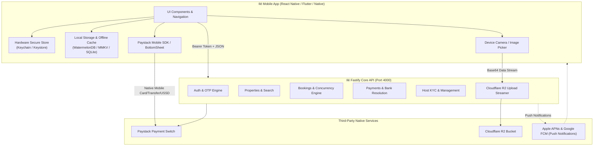
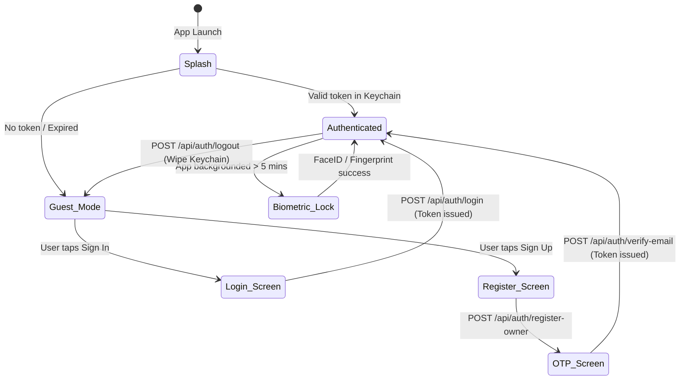
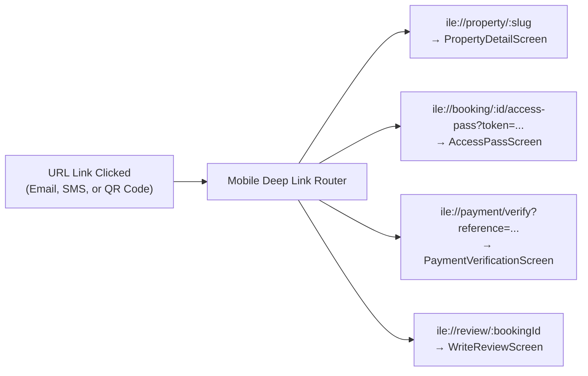

# Ilé Mobile Application — API Mapping & Architecture Blueprint

> **Document Purpose:** Authoritative engineering blueprint mapping the Ilé backend services, data models, and REST endpoints to a native mobile application (iOS & Android via React Native / Expo, Flutter, or Swift/Kotlin). This document specifies mobile authentication, screen-by-screen endpoint mapping, payment flows, offline-first caching, deep linking, and mobile-specific infrastructure recommendations.

---

## Table of Contents
1. [Mobile Architectural Strategy](#1-mobile-architectural-strategy)
2. [Mobile Authentication & Session Engine](#2-mobile-authentication--session-engine)
3. [Screen-by-Screen API Endpoint Mapping](#3-screen-by-screen-api-endpoint-mapping)
   - 3.1 [Authentication & Onboarding Flow](#31-authentication--onboarding-flow)
   - 3.2 [Explore & Discovery Flow (Guest)](#32-explore--discovery-flow-guest)
   - 3.3 [Property Detail & Availability Flow](#33-property-detail--availability-flow)
   - 3.4 [Booking & Reservation Flow](#34-booking--reservation-flow)
   - 3.5 [Native Paystack Checkout & Payment Flow](#35-native-paystack-checkout--payment-flow)
   - 3.6 [Guest Stays & Offline Access Pass Flow](#36-guest-stays--offline-access-pass-flow)
   - 3.7 [Review & Feedback Flow](#37-review--feedback-flow)
   - 3.8 [Host Partner Management Flow (Host Mode)](#38-host-partner-management-flow-host-mode)
   - 3.9 [Host KYC & Biometric Verification Flow](#39-host-kyc--biometric-verification-flow)
   - 3.10 [Profile, Banking & Account Settings](#310-profile-banking--account-settings)
4. [Master Mobile Endpoint Reference Table](#4-master-mobile-endpoint-reference-table)
5. [Deep Linking & Universal Links Schema](#5-deep-linking--universal-links-schema)
6. [Mobile Network & Offline-First Strategy](#6-mobile-network--offline-first-strategy)
7. [Recommended Mobile-Specific Backend Additions](#7-recommended-mobile-specific-backend-additions)
8. [Production Client Integration Templates](#8-production-client-integration-templates)

---

## 1. Mobile Architectural Strategy

### 1.1 Operating Context & Constraints
Developing for the Nigerian mobile ecosystem presents specific architectural requirements:
- **Variable Network Latency:** Mobile connections alternate between 4G, 3G, and Edge across carriers (MTN, Airtel, Glo, 9mobile). All network requests require aggressive retry logic, exponential backoff, and optimistic UI updates.
- **Paystack Native vs Webview SDK:** In mobile apps, payment should leverage Paystack's mobile `accessCode` parameter rather than forcing users out to an external Safari/Chrome browser.
- **Strict Bearer Authorization:** Unlike web browsers where cookies (`session_token`) are managed transparently, mobile apps must store signed JWT-like HMAC tokens in hardware-backed secure storage (iOS Keychain / Android Keystore) and deliver them via `Authorization: Bearer <token>`.
- **Offline Access Pass:** Once a guest's stay is `CONFIRMED`, the quarantined contact information (gate code, host direct phone, exact physical address) must be cached locally on the device for offline retrieval when arriving at gates where cell coverage may drop.

### 1.2 Mobile System Topology



---

## 2. Mobile Authentication & Session Engine

### 2.1 Token Storage & Header Standard
- **Token Format:** HMAC SHA-256 session token issued by `backend/src/lib/security.ts`.
- **Storage:** 
  - iOS: `kSecClassGenericPassword` via iOS Keychain.
  - Android: EncryptedSharedPreferences backed by Android Keystore.
  - React Native / Expo: `expo-secure-store` or `react-native-keychain`.
  - Flutter: `flutter_secure_storage`.
- **Header Injection:** Every authenticated HTTP request must attach:
  ```http
  Authorization: Bearer <SESSION_TOKEN>
  ```
- **Booking Access Token:** For unauthenticated or guest checkouts, the 32-byte booking token is attached via:
  ```http
  x-access-token: <BOOKING_ACCESS_TOKEN>
  ```

### 2.2 Mobile Auth State Machine



---

## 3. Screen-by-Screen API Endpoint Mapping

### 3.1 Authentication & Onboarding Flow

#### Screen: Welcome / Splash
- **Operation:** Check Keychain for saved token. If present, validate session.
- **Endpoint:** `GET /api/auth/me`
- **Headers:** `Authorization: Bearer <token>`
- **Response Handling:**
  - `200 OK`: Load user profile into global store; navigate to `HomeTab`.
  - `401 Unauthorized`: Purge Keychain; navigate to `GuestExploreTab`.

#### Screen: Login (`LoginScreen`)
- **Endpoint:** `POST /api/auth/login`
- **Request Body:**
  ```json
  {
    "email": "guest@example.com",
    "password": "Password123!"
  }
  ```
- **Response `200 OK`:**
  ```json
  {
    "success": true,
    "token": "eyJhbGciOi...",
    "user": {
      "id": "usr_abc123",
      "email": "guest@example.com",
      "firstName": "Chukwudi",
      "lastName": "Eze",
      "phone": "+2348012345678",
      "role": "guest"
    }
  }
  ```
- **Mobile Action:** Save `token` to SecureStore. Update auth state.

#### Screen: Host/Owner Registration (`RegisterOwnerScreen`)
- **Endpoint:** `POST /api/auth/register-owner`
- **Request Body:**
  ```json
  {
    "email": "host@example.com",
    "password": "SecurePassword123!",
    "firstName": "Amina",
    "lastName": "Bello",
    "phone": "+2348099887766",
    "hostType": "individual_owner",
    "operatingCity": "Abuja"
  }
  ```
- **Response `201 Created`:**
  ```json
  {
    "success": true,
    "requiresEmailVerification": true,
    "email": "host@example.com",
    "message": "Owner account created. Please verify your email with the 6-digit code sent."
  }
  ```
- **Mobile Action:** Navigate to `EmailOtpScreen` passing `email` as route parameter. Note that no session token is issued yet.

#### Screen: 6-Digit Email OTP Verification (`EmailOtpScreen`)
- **Endpoint:** `POST /api/auth/verify-email`
- **Request Body:**
  ```json
  {
    "email": "host@example.com",
    "code": "582194"
  }
  ```
- **Response `200 OK`:**
  ```json
  {
    "success": true,
    "token": "eyJhbGciOi...",
    "user": { "id": "usr_...", "role": "host", "emailVerified": true },
    "message": "Email successfully verified."
  }
  ```
- **Mobile Action:** Store received `token` in SecureStore. Navigate to `HostOnboardingWelcomeScreen`.

#### Screen: Resend OTP
- **Endpoint:** `POST /api/auth/resend-email-otp`
- **Request Body:** `{ "email": "host@example.com" }`
- **Mobile Action:** Start 60-second in-app countdown timer before re-enabling button.

#### Screen: Forgot & Reset Password (`ForgotPasswordScreen`)
- **Step 1 Request Token:** `POST /api/auth/forgot-password` with `{ "email": "..." }`
- **Step 2 Submit New Password:** `POST /api/auth/reset-password` with `{ "token": "...", "password": "..." }`

---

### 3.2 Explore & Discovery Flow (Guest)

#### Screen: Home / Explore (`HomeScreen`)
- **Description:** Infinite scrolling feed of verified luxury apartments, penthouses, and villas.
- **Endpoint:** `GET /api/properties`
- **Query Parameters:**
  - `page`: Page number (e.g. `1`, `2`)
  - `limit`: Number of items (default `20`)
- **Response `200 OK`:**
  ```json
  {
    "properties": [
      {
        "id": "prop_maitama_01",
        "slug": "maitama-penthouse-suite",
        "title": "Maitama Heights Executive Penthouse",
        "propertyType": "Penthouse",
        "spaceType": "Entire place",
        "bedrooms": 3,
        "bathrooms": 3.5,
        "pricePerNight": 180000,
        "currency": "NGN",
        "city": "Abuja",
        "neighborhood": "Maitama",
        "rating": 4.96,
        "reviewCount": 38,
        "coverImage": "https://pub-...r2.dev/properties/prop_1/cover.webp",
        "powerType": "Solar + Inverter",
        "coordinates": { "lat": 9.0882, "lng": 7.4981 }
      }
    ],
    "pagination": { "page": 1, "limit": 20, "total": 45, "totalPages": 3 }
  }
  ```
- **Mobile Action:** Render inside a VirtualizedList (`FlatList` or `FlashList`). Cache first page in local storage for instant launch.

#### Screen: Location Search Autocomplete (`SearchModalScreen`)
- **Description:** Real-time auto-suggest input querying Nigerian cities, districts, and landmarks.
- **Endpoint:** `GET /api/locations/search`
- **Query Parameters:** `?q=Wuse` (minimum 2 characters, debounced 300ms)
- **Response `200 OK`:**
  ```json
  {
    "success": true,
    "data": [
      {
        "displayName": "Wuse 2, Abuja, Federal Capital Territory",
        "city": "Abuja",
        "neighborhood": "Wuse 2",
        "latitude": 9.0747,
        "longitude": 7.4735,
        "boundingRadiusKm": 6
      }
    ]
  }
  ```

#### Screen: Search & Map Results (`SearchResultsScreen`)
- **Description:** Displays search results as an interactive map (Mapbox / Google Maps) and synchronized card carousel.
- **Endpoint:** `GET /api/search`
- **Query Parameters:**
  ```http
  GET /api/search?location=Abuja&lat=9.0765&lng=7.3986&radius=25&checkIn=2026-12-15&checkOut=2026-12-20&guests=2&powerType=Solar%20%2B%20Inverter&minPrice=50000&maxPrice=250000
  ```
- **Response `200 OK`:**
  ```json
  {
    "properties": [ ... ],
    "total": 12,
    "searchLocation": { "city": "Abuja", "lat": 9.0765, "lng": 7.3986 }
  }
  ```

---

### 3.3 Property Detail & Availability Flow

#### Screen: Property Detail (`PropertyDetailScreen`)
- **Endpoint:** `GET /api/properties/:slug`
- **Headers:** `Authorization: Bearer <token>` (optional; allows hosts/admins to preview unlisted drafts)
- **Response `200 OK`:**
  ```json
  {
    "property": {
      "id": "prop_maitama_01",
      "slug": "maitama-penthouse-suite",
      "title": "Maitama Heights Executive Penthouse",
      "tagline": "Unrivalled luxury overlooking the Abuja hills",
      "description": "Exquisite 3-bedroom serviced penthouse with dedicated fiber broadband...",
      "pricePerNight": 180000,
      "minimumNights": 2,
      "maxGuests": 6,
      "city": "Abuja",
      "neighborhood": "Maitama",
      "state": "FCT",
      "powerType": "Solar + Inverter",
      "images": [
        "https://pub-...r2.dev/properties/p1/01.webp",
        "https://pub-...r2.dev/properties/p1/02.webp"
      ],
      "amenities": [
        { "name": "24/7 Solar Electricity", "category": "comfort", "isHighlight": true },
        { "name": "Starlink High-Speed WiFi", "category": "connectivity", "isHighlight": true },
        { "name": "Private Swimming Pool", "category": "outdoor", "isHighlight": true },
        { "name": "Armed Security Guard", "category": "safety", "isHighlight": true }
      ],
      "infrastructure": {
        "powerType": "Solar + Inverter",
        "power": "5kVA Hybrid Solar array backed by dedicated 20kVA Mikano silent generator.",
        "internet": "Dedicated Starlink satellite installation (150 Mbps download).",
        "security": "Uniformed security guard at the gate plus 24/7 CCTV surveillance.",
        "water": "Industrial borehole with industrial water treatment and reverse osmosis."
      },
      "coordinates": { "lat": 9.0882, "lng": 7.4981 },
      "host": {
        "name": "Amina Bello",
        "avatar": "https://pub-...r2.dev/avatars/host_amina.webp"
      }
    }
  }
  ```

#### Screen: In-App Calendar Date Picker (`DateRangeModal`)
- **Endpoint:** `GET /api/bookings/availability`
- **Query Parameters:** `?propertyId=prop_maitama_01&checkIn=2026-12-15&checkOut=2026-12-20`
- **Response `200 OK`:**
  ```json
  {
    "available": true,
    "propertyId": "prop_maitama_01",
    "checkIn": "2026-12-15",
    "checkOut": "2026-12-20",
    "conflicts": []
  }
  ```
- **Error Response `409 Conflict`:**
  ```json
  {
    "available": false,
    "error": "Property is already booked for portions of the selected date range."
  }
  ```

---

### 3.4 Booking & Reservation Flow

#### Screen: Booking Checkout Review (`CheckoutScreen`)
- **Operation:** Computes exact price quotation, checks calendar locks, and creates an atomic `PAYMENT_PENDING` booking hold.
- **Endpoint:** `POST /api/bookings`
- **Headers:** `Authorization: Bearer <token>` (or anonymous guest checkout)
- **Request Body:**
  ```json
  {
    "propertyId": "prop_maitama_01",
    "checkInDate": "2026-12-15",
    "checkOutDate": "2026-12-20",
    "guestFirstName": "Olumide",
    "guestLastName": "Bakare",
    "guestEmail": "olumide.bakare@example.com",
    "guestPhone": "+2348031112233",
    "guestCount": 4
  }
  ```
- **Response `201 Created`:**
  ```json
  {
    "success": true,
    "booking": {
      "id": "book_7a8b9c0d1e2f",
      "referenceCode": "ILE-D4E5F6",
      "propertyId": "prop_maitama_01",
      "status": "PAYMENT_PENDING",
      "checkInDate": "2026-12-15",
      "checkOutDate": "2026-12-20",
      "numberOfNights": 5,
      "nightlyPrice": 180000,
      "accommodationSubtotal": 900000,
      "serviceFee": 2000,
      "totalAmount": 902000,
      "currency": "NGN",
      "accessToken": "32_byte_secret_hex_token_here..."
    }
  }
  ```
- **Mobile Action:** Save `booking.id` and `booking.accessToken` to memory/state. Immediately navigate to the payment screen.

---

### 3.5 Native Paystack Checkout & Payment Flow

#### Step 1: Initialize Payment Transaction
- **Endpoint:** `POST /api/payments/initialize`
- **Headers:**
  - `Authorization: Bearer <token>` (if logged in)
  - `x-booking-access-token: <booking.accessToken>`
- **Request Body:**
  ```json
  {
    "bookingId": "book_7a8b9c0d1e2f"
  }
  ```
- **Response `200 OK`:**
  ```json
  {
    "success": true,
    "reference": "ILE-D4E5F6-1730999000",
    "amount": 902000,
    "accessCode": "0987654321",
    "authorizationUrl": "https://checkout.paystack.com/0987654321",
    "gatewayProvider": "PAYSTACK"
  }
  ```

#### Step 2: Native Mobile Paystack Launch Options
Choose one of two mobile integration patterns:

##### Option A: Native Mobile SDK BottomSheet (Recommended)
Using `@paystack/react-native` or `flutter_paystack`:
```typescript
import { Paystack } from '@paystack/react-native';

<Paystack
  paystackKey="pk_live_..."
  billingEmail="olumide.bakare@example.com"
  amount="902000"
  accessCode={accessCode} // From POST /api/payments/initialize
  onCancel={(e) => { handlePaymentCancelled(); }}
  onSuccess={(res) => {
    // res.transactionRef.reference
    handlePaymentSuccess(res.transactionRef.reference);
  }}
  autoStart={true}
/>
```

##### Option B: In-App Secure Webview with Deep Link Callback
Load `authorizationUrl` inside a secure modal webview (`react-native-webview`). When Paystack redirects to `https://ilestays.ng/api/payments/verify/:reference` or custom scheme `ile://payment-complete?reference=ILE-D4E5F6-1730999000`, intercept navigation and trigger Step 3.

#### Step 3: Authoritative Verification
- **Endpoint:** `GET /api/payments/verify/:reference`
- **Response `200 OK`:**
  ```json
  {
    "verified": true,
    "status": "success",
    "reference": "ILE-D4E5F6-1730999000",
    "amount": 902000,
    "currency": "NGN",
    "booking": {
      "id": "book_7a8b9c0d1e2f",
      "status": "CONFIRMED",
      "referenceCode": "ILE-D4E5F6"
    }
  }
  ```
- **Mobile Action:** Play celebratory haptic feedback. Navigate to `BookingConfirmedScreen`. Automatically pre-cache the **Access Pass**.

---

### 3.6 Guest Stays & Offline Access Pass Flow

#### Screen: My Trips (`TripsScreen`)
- **Endpoint:** `GET /api/bookings`
- **Headers:** `Authorization: Bearer <token>`
- **Response `200 OK`:**
  ```json
  {
    "bookings": [
      {
        "id": "book_7a8b9c0d1e2f",
        "referenceCode": "ILE-D4E5F6",
        "status": "CONFIRMED",
        "checkInDate": "2026-12-15",
        "checkOutDate": "2026-12-20",
        "numberOfNights": 5,
        "totalAmount": 902000,
        "propertyTitle": "Maitama Heights Executive Penthouse",
        "propertyCoverImage": "https://pub-...r2.dev/...",
        "neighborhood": "Maitama",
        "city": "Abuja",
        "accessToken": "32_byte_secret_hex..."
      }
    ]
  }
  ```

#### Screen: Stay Access Pass (`AccessPassScreen`)
- **Description:** Critical in-app digital key revealing quarantined physical property data, security codes, and check-in instructions.
- **Endpoint:** `GET /api/bookings/:id/contact`
- **Headers:**
  - `x-access-token: <booking.accessToken>` OR `Authorization: Bearer <token>`
- **Prerequisite:** Status must be `CONFIRMED` or `COMPLETED`.
- **Response `200 OK`:**
  ```json
  {
    "bookingId": "book_7a8b9c0d1e2f",
    "referenceCode": "ILE-D4E5F6",
    "exactAddress": "Plot 1042, Amazon Street, Off Alvan Ikoku Way, Maitama, Abuja",
    "unitNumber": "Penthouse Suite 4B (4th Floor)",
    "contactName": "Amina Bello",
    "contactPhone": "+2348099887766",
    "contactEmail": "amina.bello@example.com",
    "accessGateCode": "9421#",
    "checkInInstructions": "Inform the gate guard you are the guest for Penthouse 4B. Use code 9421# on the digital elevator keypad."
  }
  ```
- **Mobile Offline Caching Rule:**
  - When received, serialize this JSON into device encrypted key-value storage (`MMKV` or `EncryptedSharedPreferences`).
  - Add native buttons:
    - **One-Tap Dial:** `Linking.openURL("tel:+2348099887766")`
    - **One-Tap WhatsApp:** `Linking.openURL("whatsapp://send?phone=2348099887766&text=Hello%20Amina,%20I%20am%20arriving%20at%20Ilé%20Maitama")`
    - **Native Turn-by-Turn Directions:** `Linking.openURL("geo:9.0882,7.4981?q=Plot+1042+Amazon+Street+Maitama")` (Android) or `maps://?daddr=9.0882,7.4981` (iOS).

---

### 3.7 Review & Feedback Flow

#### Screen: Write Review (`WriteReviewScreen`)
- **Endpoint:** `POST /api/reviews`
- **Headers:** `Authorization: Bearer <token>`
- **Request Body:**
  ```json
  {
    "bookingId": "book_7a8b9c0d1e2f",
    "overallRating": 5,
    "cleanlinessRating": 5,
    "accuracyRating": 5,
    "locationRating": 5,
    "valueRating": 5,
    "communicationRating": 5,
    "infrastructureRating": 5,
    "title": "Flawless stay in Maitama",
    "body": "The solar inverter ensured 24/7 power throughout our 5 days without any power cuts. Starlink internet was lightning fast."
  }
  ```
- **Response `201 Created`:**
  ```json
  {
    "success": true,
    "message": "Review submitted successfully. Thank you for your feedback!",
    "review": { "id": "rev_..." }
  }
  ```

---

### 3.8 Host Partner Management Flow (Host Mode)

*All endpoints require role `host` or `admin`.*

#### Screen: Host Dashboard (`HostDashboardScreen`)
- **Endpoint:** `GET /api/host/dashboard`
- **Response `200 OK`:**
  ```json
  {
    "metrics": {
      "totalProperties": 3,
      "publishedProperties": 2,
      "pendingProperties": 1,
      "activeReservations": 1,
      "totalEarnings": 3450000,
      "pendingPayouts": 720000
    },
    "upcomingReservations": [ ... ],
    "recentBookings": [ ... ]
  }
  ```

#### Screen: Host Calendar & Block Dates (`HostCalendarScreen`)
- **Fetch Blocks:** `GET /api/host/properties/:id/availability`
- **Manually Block Dates:** `POST /api/host/properties/:id/availability/block`
  - Body: `{ "startDate": "2026-12-24", "endDate": "2026-12-28", "notes": "Private family use" }`
- **Unblock Dates:** `DELETE /api/host/properties/:id/availability/block/:blockId`

#### Screen: Host Payouts Ledger (`HostPayoutsScreen`)
- **Endpoint:** `GET /api/host/payouts`
- **Response `200 OK`:**
  ```json
  {
    "payouts": [
      {
        "id": "pay_...",
        "bookingReference": "ILE-D4E5F6",
        "amount": 720000,
        "currency": "NGN",
        "status": "HELD",
        "scheduledFor": "2026-12-16T14:00:00Z",
        "bankName": "Guaranty Trust Bank",
        "accountNumber": "******4567"
      }
    ]
  }
  ```

---

### 3.9 Host KYC & Biometric Verification Flow

#### Screen: Step 3 — KYC Government ID (`HostKycIdScreen`)
- **Capture Document:** Mobile camera captures front & back of NIN card, Driver's License, or International Passport.
- **Upload Image to R2:** `POST /api/uploads`
  - Body: `{ "image": "data:image/jpeg;base64,...", "folder": "kyc/id" }`
  - Returns: `{ "url": "https://pub-...r2.dev/...", "storageKey": "..." }`
- **Update Profile KYC:** `PUT /api/host/onboarding/identity`
  ```json
  {
    "idType": "nin",
    "idNumber": "12345678901",
    "identityDocumentUrl": "https://pub-...r2.dev/kyc/id/front.webp",
    "idDocumentBackUrl": "https://pub-...r2.dev/kyc/id/back.webp"
  }
  ```

#### Screen: Biometric Camera Liveness Verification (`LivenessScreen`)
- **Description:** Mobile front-facing camera captures a verified selfie snapshot and optional 3-second liveness video clip.
- **Endpoint:** `POST /api/verification/liveness`
- **Headers:** `Authorization: Bearer <token>`, `Content-Type: multipart/form-data`
- **Form Data:**
  - `snapshot`: Binary JPEG file captured by device camera.
  - `video`: Optional WebM/MP4 binary recording.
- **Response `200 OK`:**
  ```json
  {
    "success": true,
    "verificationId": "live_a1b2c3d4...",
    "snapshotUrl": "https://pub-...r2.dev/kyc/liveness/snapshot.jpg",
    "verifiedAt": "2026-11-07T14:30:00Z",
    "message": "Biometric liveness verification completed successfully."
  }
  ```

---

### 3.10 Profile, Banking & Account Settings

#### Screen: Payout Bank Setup (`BankSetupScreen`)
- **Step 1 Load Bank Directory:** `GET /api/banks`
  - Populates native Picker/Modal with Nigerian banks (GTBank, Zenith, Access, Kuda, Moniepoint, etc.).
- **Step 2 Auto-Resolve NUBAN:** `POST /api/bank-accounts/resolve`
  - Request: `{ "accountNumber": "0123456789", "bankCode": "058" }`
  - Response: `{ "resolved": true, "accountName": "BABATUNDE ADEYEMI" }`
  - Mobile Action: Display the resolved account name in green with a checkmark badge.
- **Step 3 Save Authority & Bank Details:** `PUT /api/host/onboarding/authority`
  ```json
  {
    "bankName": "Guaranty Trust Bank",
    "bankCode": "058",
    "bankAccountNumber": "0123456789",
    "bankAccountName": "BABATUNDE ADEYEMI",
    "authorityDocType": "deed_of_ownership",
    "authorityDocUrl": "https://pub-...r2.dev/authority/deed.pdf"
  }
  ```

#### Screen: Submit Host Application for Approval
- **Endpoint:** `POST /api/host/onboarding/submit`
- **Response `200 OK`:** Transitions host state to `IN_REVIEW`.

---

## 4. Master Mobile Endpoint Reference Table

| Mobile Screen / Journey | HTTP Method & URI | Auth Required | Cache Policy |
|---|---|---|---|
| **Splash / Session Check** | `GET /api/auth/me` | Bearer Token | Network Only |
| **Login** | `POST /api/auth/login` | None | Network Only |
| **Host Registration** | `POST /api/auth/register-owner` | None | Network Only |
| **Verify Email OTP** | `POST /api/auth/verify-email` | None | Network Only |
| **Resend Email OTP** | `POST /api/auth/resend-email-otp` | None | Network Only |
| **Forgot Password** | `POST /api/auth/forgot-password` | None | Network Only |
| **Reset Password** | `POST /api/auth/reset-password` | None | Network Only |
| **Explore Home Feed** | `GET /api/properties` | None | Cache-First (5 mins) |
| **Property Details** | `GET /api/properties/:slug` | Optional Bearer | Cache-First (15 mins) |
| **Date Availability** | `GET /api/bookings/availability` | None | Network Only |
| **Location Autocomplete** | `GET /api/locations/search` | None | Memory Cache (1 hour) |
| **Filter & Geo-Search** | `GET /api/search` | None | Network Only |
| **Create Booking Hold** | `POST /api/bookings` | Optional Bearer | Network Only |
| **Cancel Booking** | `POST /api/bookings/:id/cancel` | Bearer / Access Token | Network Only |
| **Paystack Init** | `POST /api/payments/initialize` | Bearer / Access Token | Network Only |
| **Paystack Verify** | `GET /api/payments/verify/:reference` | None | Network Only |
| **My Stays / Trips** | `GET /api/bookings` | Bearer Token | Cache-and-Network |
| **Stay Access Pass** | `GET /api/bookings/:id/contact` | Bearer / Access Token | **Offline Storage (Permanent)** |
| **Submit Review** | `POST /api/reviews` | Bearer Token | Network Only |
| **Property Reviews** | `GET /api/reviews/property/:id` | None | Cache-First (10 mins) |
| **Host Dashboard** | `GET /api/host/dashboard` | Host Bearer | Network Only |
| **Host Listings** | `GET /api/host/properties` | Host Bearer | Cache-and-Network |
| **Create Listing** | `POST /api/host/properties` | Host Bearer | Network Only |
| **Update Listing** | `PUT /api/host/properties/:id` | Host Bearer | Network Only |
| **Calendar Blocks** | `GET /api/host/properties/:id/availability` | Host Bearer | Network Only |
| **Block Dates** | `POST /api/host/properties/:id/availability/block` | Host Bearer | Network Only |
| **Unblock Dates** | `DELETE /api/host/properties/:id/availability/block/:blockId` | Host Bearer | Network Only |
| **Host Payouts Ledger**| `GET /api/host/payouts` | Host Bearer | Network Only |
| **Host KYC Status** | `GET /api/host/onboarding/status` | Host Bearer | Network Only |
| **Update KYC Profile** | `PUT /api/host/onboarding/profile` | Host Bearer | Network Only |
| **Update KYC Identity**| `PUT /api/host/onboarding/identity` | Host Bearer | Network Only |
| **Biometric Liveness** | `POST /api/verification/liveness` | Host Bearer | Network Only |
| **Nigerian Bank List** | `GET /api/banks` | None | Local Fallback / 24h Cache |
| **NUBAN Resolution** | `POST /api/bank-accounts/resolve` | None | Network Only |
| **Save Bank & Authority**| `PUT /api/host/onboarding/authority` | Host Bearer | Network Only |
| **Submit Host KYC** | `POST /api/host/onboarding/submit` | Host Bearer | Network Only |
| **Photo Upload (R2)** | `POST /api/uploads` | Bearer Token | Network Only |
| **Image CDN Stream** | `GET /api/uploads/image?key=...` | None | Disk Cache (365 days) |

---

## 5. Deep Linking & Universal Links Schema

Configure native iOS Universal Links (`apple-app-site-association`) and Android App Links (`assetlinks.json`) alongside custom URL scheme `ile://`.



### Supported Routes & Link Actions

| Scheme Pattern | Target Mobile Screen | Action |
|---|---|---|
| `ile://property/:slug`<br>`https://ilestays.ng/stay/:slug` | `PropertyDetailScreen` | Loads full listing details |
| `ile://booking/:id/access-pass?token=<ACCESS_TOKEN>`<br>`https://ilestays.ng/trips/:id` | `AccessPassScreen` | Loads quarantined gate codes & address |
| `ile://payment/verify?reference=<REF>` | `PaymentVerificationModal` | Triggers `/api/payments/verify/:reference` |
| `ile://review/:bookingId` | `WriteReviewScreen` | Opens post-checkout review sheet |
| `ile://host/dashboard` | `HostDashboardScreen` | Switches to Host mode dashboard |

---

## 6. Mobile Network & Offline-First Strategy

### 6.1 Critical Data Offline Strategy (The Access Pass)
Cell service can be inconsistent near estate gates in Abuja and Lagos (e.g. Asokoro Hills, Guzape, Lekki Phase 1). The mobile app must treat the **Access Pass** as a mission-critical offline artifact:
1. When a booking confirms, the app immediately fetches `GET /api/bookings/:id/contact`.
2. The payload is written to persistent secure storage.
3. If the user navigates to the Access Pass without an active internet connection, the UI renders directly from cache with a clear badge:
   > 🟢 **Offline Access Pass Active** — Gate codes and address stored on device.

### 6.2 Image Caching & Compression Protocol
- **Display Caching:** Use `react-native-fast-image` (React Native) or `cached_network_image` (Flutter). Cloudflare R2 serves immutable cache headers (`max-age=31536000`).
- **Upload Compression:** Before posting images to `POST /api/uploads`, compress files locally on the device:
  - Max dimension: `1920x1080px`.
  - Format: WebP or JPEG at `80%` quality.
  - Target binary size: under `800 KB` (reducing upload failure rates on Nigerian cellular connections).

---

## 7. Recommended Mobile-Specific Backend Additions

To deliver a first-class mobile experience, implement the following four dedicated endpoints on the Fastify server:

### 1. Push Notification Registration
- **Endpoint:** `POST /api/mobile/push-token`
- **Auth:** Bearer Token
- **Request Body:**
  ```json
  {
    "deviceToken": "fcm_or_apns_token_string...",
    "platform": "ios", // "ios" | "android"
    "appVersion": "1.0.0"
  }
  ```
- **Purpose:** Stores push tokens for arrival reminders, gate code alerts, and host booking notifications.

### 2. Mobile App Configuration & Version Control
- **Endpoint:** `GET /api/mobile/config`
- **Auth:** None
- **Response:**
  ```json
  {
    "minSupportedVersion": "1.0.0",
    "latestVersion": "1.2.0",
    "forceUpdate": false,
    "maintenanceMode": false,
    "whatsappSupportPhone": "+2348000000000",
    "paystackPublicKey": "pk_live_..."
  }
  ```
- **Purpose:** Enables force-updates on breaking API changes, maintenance banners, and dynamic WhatsApp support links.

### 3. Native Apple / Google Social Identity Handshake
- **Endpoint:** `POST /api/auth/oauth/apple` & `POST /api/auth/oauth/google`
- **Request Body:** `{ "identityToken": "jwt_from_apple_or_google..." }`
- **Purpose:** Verifies identity tokens natively on the backend, creating or logging in the user without needing web redirects.

---

## 8. Production Client Integration Templates

### 8.1 Typed API Client with Secure Token Injection (Axios / TypeScript)

```typescript
// services/apiClient.ts
import axios from 'axios';
import * as SecureStore from 'expo-secure-store';

const API_BASE_URL = 'https://il-production.up.railway.app'; // Or local dev: http://10.0.2.2:4000 (Android) / http://localhost:4000 (iOS)

export const apiClient = axios.create({
  baseURL: API_BASE_URL,
  timeout: 15000,
  headers: {
    'Content-Type': 'application/json',
  },
});

// Automatic Bearer Token Interceptor
apiClient.interceptors.request.use(async (config) => {
  const token = await SecureStore.getItemAsync('ile_session_token');
  if (token) {
    config.headers.Authorization = `Bearer ${token}`;
  }
  return config;
});

// Global 401 Session Expiry Interceptor
apiClient.interceptors.response.use(
  (response) => response,
  async (error) => {
    if (error.response?.status === 401) {
      await SecureStore.deleteItemAsync('ile_session_token');
      // Emit event to redirect user to LoginScreen
    }
    return Promise.reject(error);
  }
);
```

### 8.2 Paystack Native Mobile Checkout Execution

```typescript
// hooks/usePaystackCheckout.ts
import { useState } from 'react';
import { apiClient } from '../services/apiClient';

export function usePaystackCheckout() {
  const [loading, setLoading] = useState(false);

  async function initiatePayment(bookingId: string, accessToken: string) {
    setLoading(true);
    try {
      // 1. Request accessCode from Ilé backend
      const { data } = await apiClient.post(
        '/api/payments/initialize',
        { bookingId },
        { headers: { 'x-booking-access-token': accessToken } }
      );

      if (!data.success || !data.accessCode) {
        throw new Error(data.error || 'Failed to initialize transaction');
      }

      return {
        accessCode: data.accessCode,
        reference: data.reference,
        amount: data.amount,
      };
    } finally {
      setLoading(false);
    }
  }

  async function verifyPayment(reference: string) {
    const { data } = await apiClient.get(`/api/payments/verify/${reference}`);
    return data;
  }

  return { initiatePayment, verifyPayment, loading };
}
```

---

*This specification establishes the official mobile integration standard for the Ilé platform. Refer to [`backend.md`](file:///c:/Users/user/Desktop/NEXT_HOME/backend.md) for database tables, accounting ledger journal entries, and server-side business rules.*
